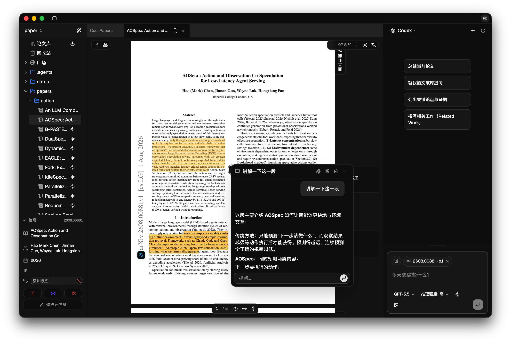
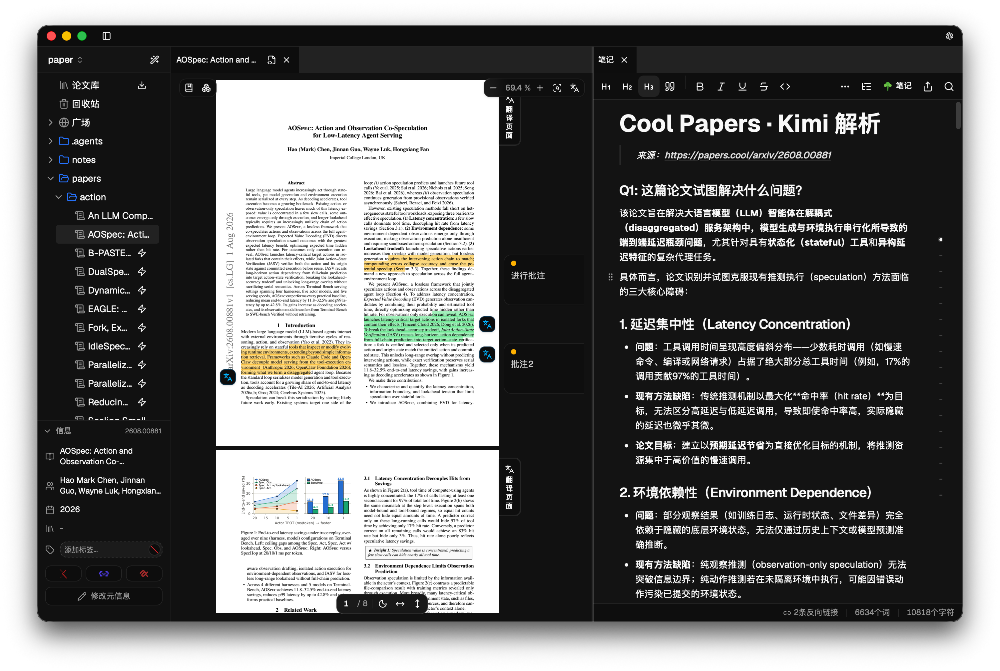
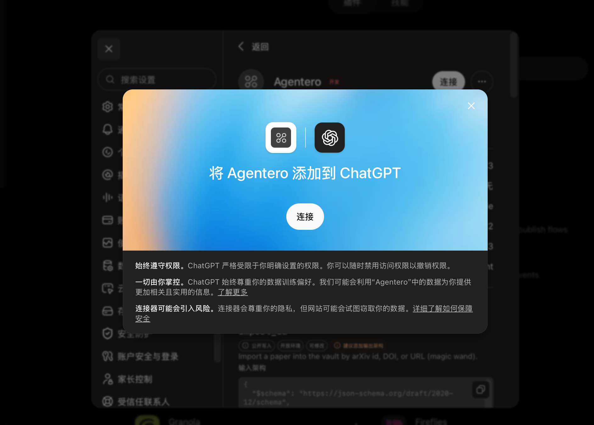
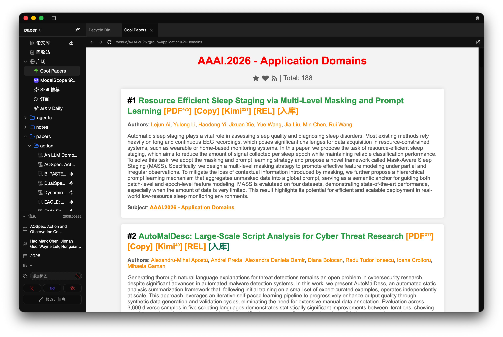
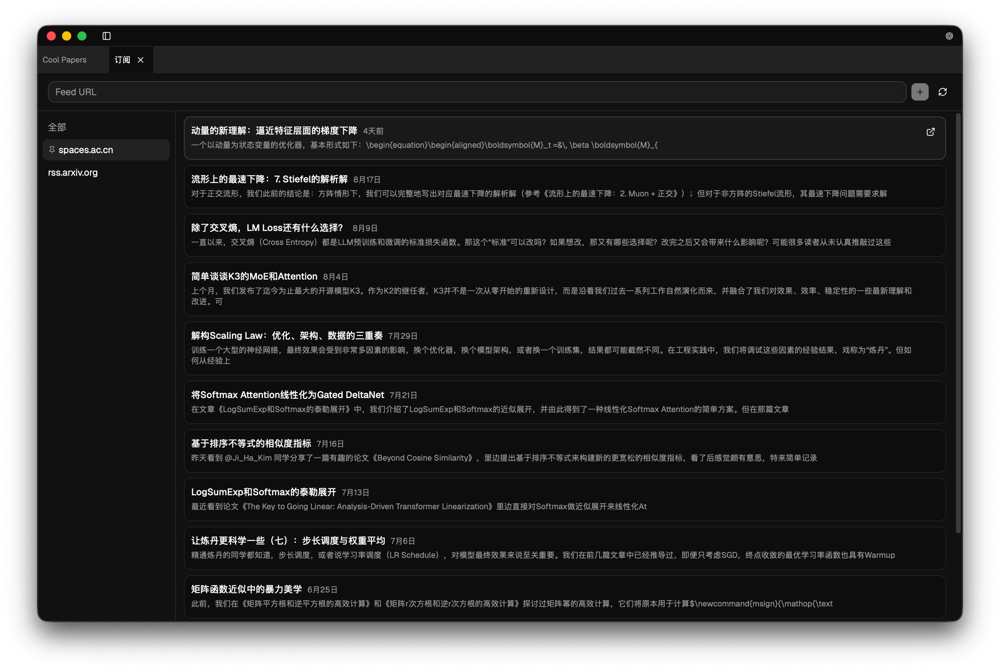
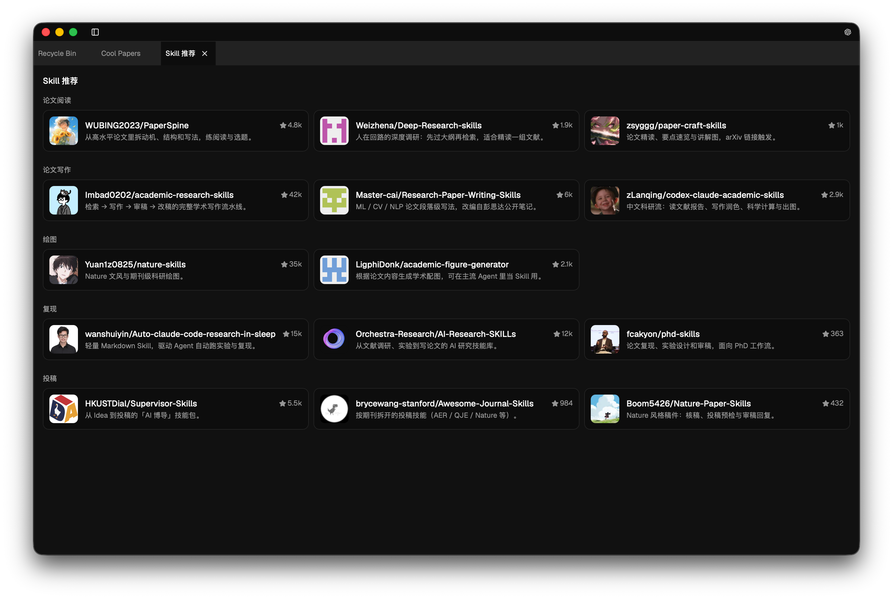
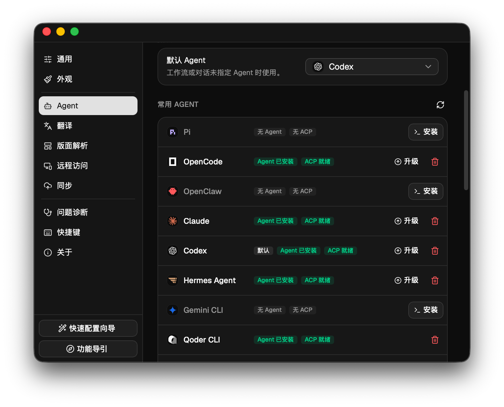
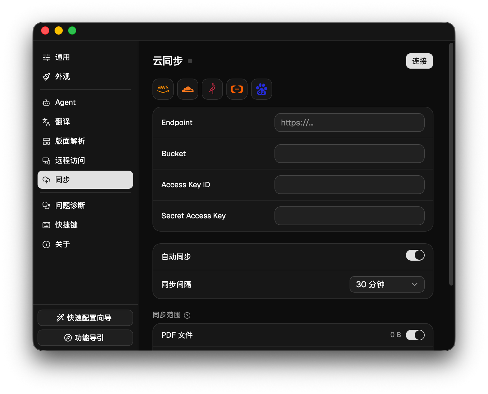
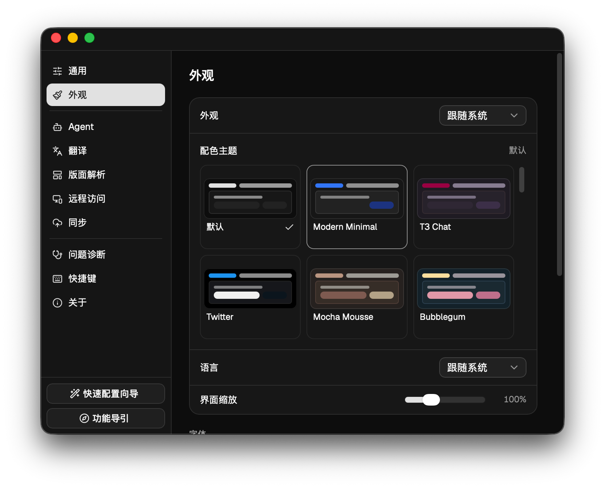

<p align="center">
  
</p>

<h3 align="center">An All-in-One Research Workbench Built for Human–Agent Collaboration</h3>

<p align="center">
  Keep the PDF reading experience humans love, while giving models clean, structured context; papers, notes, and interaction records all stay on your local machine.
</p>

<p align="center">
  <a href="https://github.com/poco-ai/agentero/stargazers"></a>
  <a href="https://github.com/poco-ai/agentero/releases"></a>
  <a href="LICENSE"></a>
  <a href="https://agentero.app/"></a>
  <a href="https://agentero-docs.poco-ai.com"></a>
</p>

<p align="center">
  <a href="README.md">中文</a> | <b>English</b>
</p>

If this project helps you, please **give it a star** on GitHub!

<p align="center">
  <a href="https://github.com/poco-ai/agentero/stargazers"></a>
</p>

---

## Background & Motivation

Zotero is an excellent piece of software for academic reference management. It is mature, stable, and has helped many researchers build their first literature archives.

However, when it comes to daily research and deep use of large language models (LLMs) and agents, the traditional tool chain exposes a few breakpoints:

* **Severely fragmented context**: papers live in Zotero, notes in Obsidian, and the reasoning and analysis done with models remain scattered across web chat windows. The three are isolated from each other; when you want an agent to reason deeply over a specific paper together with your past notes, you have to copy and paste back and forth by hand.
* **Paper formats are unfriendly to models**: humans are used to reading well-typeset PDFs, but for models, parsing two-column layouts, multi-page tables, complex math, and cross-references is extremely costly and prone to recognition errors and hallucinations. Structured Markdown and LaTeX are far easier for models to understand accurately.
* **High maintenance cost**: high-frequency needs such as AI-assisted reading, full-text translation, and note syncing usually require installing and tuning multiple community plugins — a high configuration barrier, with compatibility issues whenever versions change.
* **Limited batch automation**: the large number of papers discovered via Deep Research or automated search tools still need to be saved manually, one by one in the browser, making them hard to fit into a smooth batch research workflow.

**Agentero is not meant to replace Zotero. It explores a new way for humans and agents to handle research context together**:
* **Humans** pose research questions, make scholarly judgments, read in depth, and derive core conclusions;
* **Agents** handle batch retrieval and filtering, metadata fetching, figure/formula extraction, citation graph mapping, and basic summarization.

---

## Core Features

### 1. Structured Reading & Notes
* **PDF reading and annotation**: outline navigation, fit-page and fit-width modes, smooth text selection, highlights and annotations, and full-text search.
* **Figure & formula extraction**: automatically parses math formulas, algorithm pseudocode, and tables into structured Markdown and LaTeX content, ensuring agents receive accurate context when invoked.
* **Bi-directional linked notes**: a built-in WYSIWYG Markdown editor with `[[wikilinks]]`, `/` slash commands, and live LaTeX rendering, natively linking notes to papers.
* **Multi-mode translation**: selection-based, side-by-side page-level, and full-text translation, with built-in available channels and support for custom API keys (BYOK).

<p align="center">
  
  <br/>
  <sub>Split-view reading and analysis: highlights and annotations on the left, a local agent answering and reasoning over accurate structured context on the right</sub>
</p>

<p align="center">
  
  <br/>
  <sub>Selection translation with live capture: points extracted while reading flow straight into local Markdown notes</sub>
</p>

---

### 2. Open Agent Protocols & Automation Interfaces
* **Local agents via ACP**: built on the Agent Client Protocol, supports connecting various locally running agents (e.g., Claude Code, OpenCode, Codex, or local models) — no vendor lock-in, with all context kept fully local.
* **Built-in MCP (Model Context Protocol)**: runs as an MCP server, letting external clients such as ChatGPT Web and Claude Desktop query your local library as context.
* **CLI for hackers**: a built-in headless CLI for scripted workflows such as batch paper import, metadata extraction, and note writing.

<p align="center">
  
  <br/>
  <sub>Built-in MCP server connects your local library seamlessly to external AI clients</sub>
</p>

---

### 3. Academic Radar & Paper Discovery
* **Multi-source ingestion**: built-in integration with [Cool Papers](https://papers.cool/) and the ModelScope community — browse and archive papers in one click inside the app; academic RSS subscriptions supported.
* **Personalized recommendations**: daily arXiv recommendations based on the content of your local library.
* **Automatic citation mapping**: parses reference lists automatically with one-click batch import; fetches publisher metadata and tracks citations forward.

<p align="center">
  
  <br/>
  <sub>Browse trending Cool Papers inside the app and import them into your local knowledge base in one click</sub>
</p>

---

### 4. Zotero Compatibility & Transparent Local Storage
* **Seamless Zotero migration**: import an entire Zotero database in one click, keeping tags, notes, and attachments; works with the Zotero browser extension to save papers from the web; export to BibTeX / BibLaTeX.
* **Transparent local folders**: no proprietary database or obfuscated directory layout — papers and notes are stored as plain files (PDF, Markdown) in a regular folder structure that any external editor can read.
* **Multi-device sync & remote access**: sync with any S3-compatible cloud storage; access a library deployed on a remote server over an SSH tunnel.

---

## UI & Feature Preview

<details>
<summary><b>Click to expand: more screenshots (RSS subscriptions, Skill extensions, agent settings, S3 sync, themes)</b></summary>
<br/>

#### 1. Academic RSS subscriptions
Track academic blogs, lab homepages, and frontier updates:
<p align="center">
  
</p>

#### 2. Agent Skill extensions
Browse and install community research skills to extend close-reading and writing analysis:
<p align="center">
  
</p>

#### 3. Agent & connection settings
Manage, upgrade, and switch local agents via ACP:
<p align="center">
  
</p>

#### 4. S3-compatible cloud sync
Configure private or commercial S3 storage to sync your knowledge base across devices:
<p align="center">
  
</p>

#### 5. Multiple themes
Light/dark and multiple color schemes, following your system appearance:
<p align="center">
  
</p>

</details>

---

## Quick Start

### Desktop app (macOS / Windows / Linux)

Download prebuilt installers for each platform from the **[official website](https://agentero.app/)** or **[GitHub Releases](https://github.com/poco-ai/agentero/releases)**.

#### macOS (Homebrew)
```bash
brew tap poco-ai/agentero
brew install --cask agentero

```

> **Note for Linux users**: Ubuntu 22.04+ is required (`webkit2gtk 4.1`).

---

### Command-line tool (CLI)

To manage your library from the terminal or scripted workflows:

```bash
brew tap poco-ai/agentero
brew install agentero

# List commands and options
agentero --help

```

---

### Use Agentero in more places

- **DeepSeek Harness (dsh) plugin**: use the Agentero library, notes, and PDF reader directly inside [DeepSeek Harness](https://github.com/deepseek-ai/deepseek-harness). Install with `dsh plugin --profile web add @poco-ai/agentero-dsh`; see [agentero-dsh-plugin](https://github.com/poco-ai/agentero-dsh-plugin).

---

## Acknowledgements & Community

* Thanks to the [LinuxDo](https://linux.do/) and [ModelScope](https://modelscope.cn/) communities for their suggestions and feedback during early testing.
* Thanks to [AtomGit](https://gitcode.com/poco-ai/Agentero) for hosting the domestic mirror.

### Community chat

<p align="center">
  
  <br/>
  <sub>Scan to join the WeChat user group (Chinese-speaking) for tips, feedback, and release news. The QR code is valid for 7 days; if it has expired, leave a note in the <a href="https://github.com/poco-ai/Agentero/issues">Issues</a>.</sub>
</p>

If Agentero helps your daily research, please consider giving the project a **⭐ Star** on GitHub.

Thanks to all contributors!


## Star History

[](https://www.star-history.com/?type=date&repos=poco-ai%2Fagentero)

## License

This project is licensed under the [MIT License](LICENSE). Third-party components and their licenses are listed in [.github/THIRD_PARTY_NOTICES.md](.github/THIRD_PARTY_NOTICES.md).
