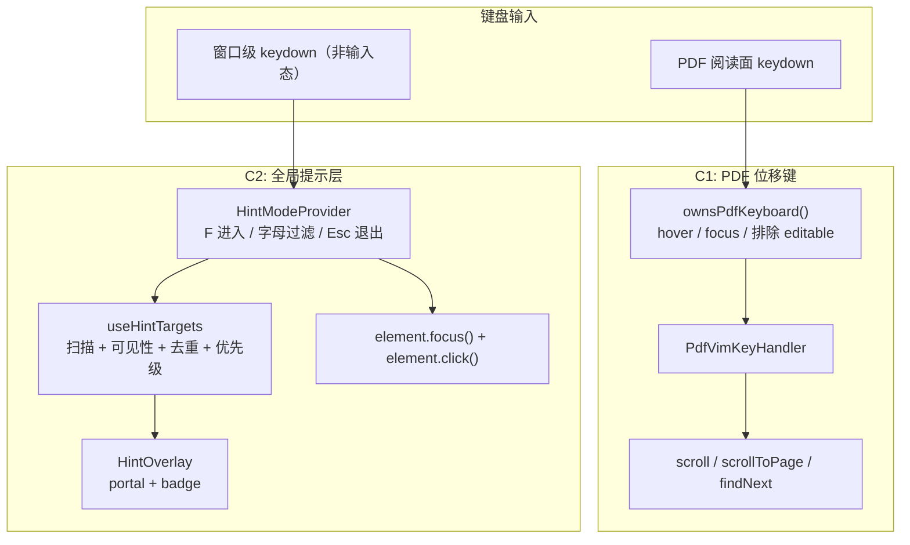
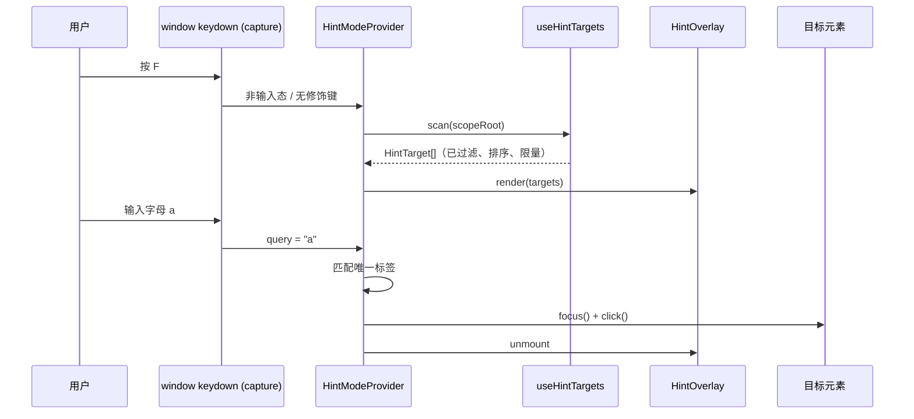

# [RFC]: 键盘导航层 —— PDF 位移键与全局元素提示

> 状态：草稿（待评审）  
> 日期：2026-11-09  
> 范围：桌面端前端（React / Dockview / EmbedPDF），不改数据模型与 IPC 契约

## 摘要

为桌面端增加一层可选的键盘导航能力，拆成两个互相独立、可分别开关的子能力：

1. **PDF 位移键（C1）**：在 PDF 阅读面用 `j/k/h/l/d/u/J/K/gg/G/数字` 完成滚动、翻页与跳页，不涉及 PDF 内容链接提示。
2. **全局元素提示（C2）**：按 `F` 在当前窗口（或最上层对话框）内给可交互元素打字母标签，输入字母直接点击对应按钮，覆盖标签页、标题栏、侧栏、Agent 按钮、PDF 工具栏等应用 Chrome。

两者共享"当前哪个表面拥有键盘"的归属模型，但 UI 与状态机彼此独立。目标不是把应用改造成 Vim，而是补齐"已经看见、但不想摸鼠标"的入口。

---

## 背景与动机

### 现状

| 能力 | 现状 | 限制 |
|---|---|---|
| 全局快捷键 | `src/lib/shell/shortcuts.ts` + `use-app-shortcuts.ts`，以 `⌘/⌃/⌥/⇧` 组合键为主 | 只能覆盖有快捷键的动作；工具栏图标、标签页等空间目标没有入口 |
| 命令面板 | `⇧⌘P` 命令面板 + `src/lib/shell/commands/registry.ts` | 解决"知道动作名"的场景；不知道命令名、或目标是一个具体标签页时无能为力 |
| PDF 滚动 | `keyboard-scroll-handler.tsx`：↑↓ 滚动/翻页；`page-turn-handler.tsx`：分页模式 PageUp/PageDown | 没有 Vim 风格位移键；方向键需要手离开主键区 |
| PDF 跳转 | `use-pdf-navigation.ts` 的 `goToPage`、`use-pdf-find.ts` 的 `findNext/findPrev`、`use-pdf-jump-back.ts` | 能力已存在，但没有统一的键盘入口 |
| 元素标记 | 标题栏已有 `data-tb-sidebar` / `data-tb-agent` 等属性 | 没有统一的可提示目标约定，也没有提示层 |
| 输入保护 | `shortcutBelongsToTextField()`、`isEditableClipboardTarget()`、`EXCLUDED` 选择器 | 可复用，避免单字母键在编辑器/输入框中误触 |

### 痛点

- 高频动作（切标签页、开合 Agent、切侧栏、PDF 工具栏）主要靠鼠标，快捷键覆盖不全。
- 命令面板是"搜索式"入口，无法表达"点左边第二个标签页"这种空间目标。
- PDF 阅读是长时间连续操作，方向键需要手离开 `hjkl` 区域，和用户已有的 Vim/终端习惯断裂。
- 现有 `F` 在非输入状态下没有占用，是低成本切入点。

### 为什么不直接照搬 Vimium

- PDF 是 canvas，不是 DOM，不能全量扫描可点击元素；本 RFC 明确**不做 PDF 内容提示**。
- 桌面应用的按钮密度远低于网页，全量扫描会产生"标签雨"，必须做目标筛选。
- 单字母键必须服从输入框/编辑器/IME 的优先级，不能做成无条件 `window` 监听。

---

## 目标与非目标

### 目标

- C1：PDF 阅读面支持 Vim 风格位移键，行为与现有方向键/翻页逻辑一致，不新增第二套滚动实现。
- C2：`F` 进入提示模式，给当前作用域内**经过筛选**的可交互元素打标签，输入字母完成点击。
- 两个能力都可以在设置中关闭；默认策略见「开放问题」。
- 不破坏现有快捷键、文本输入、选区批注、命令面板与无障碍焦点顺序。

### 非目标

- 不做 PDF 正文/引用/图表的链接提示。
- 不做完整的 Vim 模式（normal/insert/visual/寄存器/宏），不引入 `:` 命令行。
- 不做跨窗口提示；多窗口各自独立。
- 不替代命令面板，不把设置页的每个开关都纳入提示。
- 首版不做用户自定义提示键位（`F` 先固定，后续可接入快捷键注册表）。

---

## 方案总览



两个子能力共享两条约束：

1. **表面归属**：只有当前表面拥有键盘时才消费按键。PDF 已有 `host.matches(":hover")` + focus 兜底模型；全局提示层用"非 editable + 无修饰键 + 非组合输入"。
2. **不抢原生输入**：`input` / `textarea` / `[contenteditable]` / `select` / 菜单 / 树 / 对话框中，字母键保持原义。

---

## C1：PDF 位移键

### 触发与归属

复用 `keyboard-scroll-handler.tsx` 的 ownership 规则，抽出纯函数：

```ts
// src/lib/pdf/keyboard-ownership.ts
export function ownsPdfKeyboard(args: {
  target: EventTarget | null;
  host: HTMLElement | null;
  active: boolean;
}): boolean;
```

规则保持不变：

- 目标在 `[data-pdf-chrome]`、`[role=dialog/menu/tree/grid/...]`、`input/textarea/select/contenteditable` 内 → 不拥有；
- `host.matches(":hover")` → 拥有；
- 否则仅当 `active` 且焦点不在其他可编辑表面时拥有。

### 键位

| 键 | 连续滚动模式 | 分页模式 | 说明 |
|---|---|---|---|
| `j` / `k` | 向下/向上滚动 | 向下/向上滚动（不翻页） | 复用现有 `ARROW_SCROLL_STEP_PX` 或 scroll capability |
| `d` / `u` | 半页 | 半页 | 可选，Phase 1 一并实现 |
| `h` / `l` | 横向滚动 | 上一页/下一页 | 单页纵向布局下 `h/l` 映射为翻页，避免空操作 |
| `J` / `K` | 下一页/上一页 | 下一页/上一页 | 与 Zathura 一致；连续模式也允许整页跳 |
| `gg` / `G` | 文首/文末 | 文首/文末 | 复用 `scrollToPage` / 布局首尾 |
| `{n}G` | 跳到第 n 页 | 跳到第 n 页 | 复用 `goToPage`；`n` 为数字前缀 |
| `n` / `N` | 下一个/上一个搜索命中 | 同左 | 复用 `findNext/findPrev`；无搜索时忽略 |
| `Esc` | 清除数字前缀/退出状态 | 同左 | 不关闭 PDF 标签 |

不处理带 `⌘/⌃/⌥` 的组合键；`⇧` 仅参与大小写区分（`G` vs `g`）。

### 边界

- 不监听 PDF 内容区文本选择层之外的点击；提示层不进入 PDF canvas。
- 与现有 ↑↓ / PageUp / PageDown 并存，不重映射。
- 双窗格（split view）中沿用 hover 归属：鼠标/焦点所在窗格优先。
- 选区非空时，`Esc` 先清选区语义由现有逻辑决定，本 RFC 不改变。

### 文件改动

| 文件 | 动作 |
|---|---|
| `src/lib/pdf/keyboard-ownership.ts` | 新增；从 `keyboard-scroll-handler.tsx` 抽 ownership |
| `src/components/viewer/pdf/viewport/pdf-vim-key-handler.tsx` | 新增；实现上表与数字前缀 |
| `src/components/viewer/pdf/viewport/keyboard-scroll-handler.tsx` | 改为复用 `ownsPdfKeyboard`，行为不变 |
| `src/lib/settings/store.ts` | 增加 `pdfVimKeys: boolean` 与归一化默认值 |
| `src/components/settings/panes/general-pane.tsx` | 增加开关（与 `pdfScrollStrategy` 同组） |

---

## C2：全局元素提示

### 状态机

```text
idle
  -- F（非输入态、无修饰键、非 composing） --> collecting
collecting
  -- 字母 --> filtering（追加 query）
  -- Backspace --> filtering（删除一位）
  -- 唯一命中 --> clicking --> idle
  -- Esc --> idle
  -- 滚动 / resize / 窗口失焦 / 目标被卸载 --> idle
```

`collecting` 只在进入时扫描一次 DOM，提示层存活期间不持续监听滚动。滚动、窗口尺寸变化、焦点变化都直接退出，避免标签与目标错位。

### 目标发现

采用"显式标记优先 + 通用选择器兜底"的混合策略，避免全量扫描：

```ts
// 显式目标
const EXPLICIT = "[data-hint]";

// 兜底目标：只在显式目标不足时参与
const GENERIC = [
  "button:not([disabled])",
  "[role='tab']",
  "[role='button']",
  "a[href]",
].join(",");
```

优先级：

| 优先级 | 目标 | 标记 / 来源 |
|---|---|---|
| 1 | 文档标签页、标题栏按钮、侧栏顶部操作、Agent 面板头部、PDF 工具栏 | `data-hint` 或 `data-hint-priority="1"` |
| 2 | 当前可见面板内的主按钮、空状态主操作、批注菜单项 | 通用选择器自动发现 |
| 3 | 设置页控件、下拉菜单、低频开关 | 不进入提示层 |

显式约定：

```tsx
<button data-hint data-hint-priority="1" aria-label="…">…</button>

// 需要排除的容器
<div data-hint-ignore>…</div>
```

过滤规则：

- 跳过 `disabled`、`aria-disabled="true"`、`inert`、`hidden`、`display:none`、`visibility:hidden`、`opacity:0`；
- `getBoundingClientRect()` 宽高均 ≥ 8px，且与视口相交；
- 跳过 `[data-pdf-content]`、`canvas`、`[contenteditable]`、`input`、`textarea`、`select`；
- 嵌套去重：`element.closest("button, [role='tab'], [role='button'], a[href]")`，一个目标只出一个标签；
- 上限 60 个；超出时按 `priority` 升序（1 优先）再按 DOM 顺序截断。

### 标签生成

```ts
// src/lib/keyboard/hint-labels.ts
export function assignHintLabels(count: number, alphabet?: string): string[];
export function matchHintLabel(query: string, labels: string[]): string | null;
```

- 字母表使用主键区、避免易混字符：`asdfghjklqwertyuiopzxcvbnm`，排除 `l/1/o/0` 这类歧义组合中的数字；
- 超过字母表容量时生成两位标签（`aa`、`as`、…），首位先变化，保证前缀可预测；
- 标签大写显示、输入不区分大小写；
- 顺序按目标的视觉位置（上→下、左→右）稳定排序，便于形成肌肉记忆；
- `Backspace` 逐位删除；无命中时保持 `collecting`，不清空已输入前缀，除非用户按 `Esc`。

### 覆盖层

- 通过 `createPortal` 挂到 `document.body`；`position: fixed`，坐标来自进入瞬间的 `getBoundingClientRect()`；
- 覆盖层 `pointer-events: none`，标签本身也默认不接收指针事件，避免拦截用户点击；
- `z-index` 高于普通 UI、低于最上层 Dialog；进入时记录作用域根节点，标签只在根节点内定位；
- 主题：使用 accent/amber 变体，深色文字 + 描边；不使用纯黄底白字；
- 标签 `aria-hidden="true"`，真实按钮保留自身 `aria-label`；
- `prefers-reduced-motion` 下只做透明度变化，不做缩放/位移动画；
- 目标被 React 卸载（`!element.isConnected`）时点击前二次校验，失效则退出。

### 键盘处理

- 监听器注册在 `capture` 阶段，先于 Radix/Dockview 的内部处理；
- 进入条件：`event.key === "F"`（或配置键）、无 `⌘/⌃/⌥`、`!event.isComposing`、`!event.repeat`；
- 输入保护：`target.closest("input, textarea, select, [contenteditable]")` 或 `shortcutBelongsToTextField` 命中 → 不进入；
- 选区保护：`window.getSelection()?.isCollapsed === false` 时不进入，避免打断"选中文本 → 批注"流程；
- 模式期间：字母/Backspace/Esc 由提示层消费并 `preventDefault`；其他键（`Tab`、方向键）默认退出提示层并放行；
- 点击语义：`element.focus({ preventScroll: true })` 后 `element.click()`；对 `role=tab`/`role=button` 同样适用；`disabled` 已在扫描阶段排除。

### 作用域

- 如果存在最上层模态对话框（`overlay-stack` 中的顶部 `modal`，或 DOM 中最后一个 `[data-slot="dialog-content"][data-open]`），**只扫描该对话框内部**；
- 否则扫描当前 `WebviewWindow` 的 `document.body`；
- 不跨窗口、不跨 iframe（应用内若有 iframe，如 PDF 翻译页，不进入提示范围）；
- 提示层本身不注册到 `overlay-stack`，避免被 `Esc` 的全局关闭逻辑误关；它自己处理 `Esc`。

### 可访问性

- 提示层是**并行入口**，不是替代：所有目标仍然可以通过 `Tab` 聚焦，按钮保留可访问名称；
- 进入/退出提示模式时通过 `aria-live="polite"` 播报状态与候选数；退出后清除播报；
- 标签颜色不是唯一信息：同时显示字母，且目标有可见焦点环；
- 不改变 DOM 顺序与 `tabIndex`；
- 对比度满足 WCAG AA；深色/浅色主题分别验证。

### 设置与发现

| 项 | 位置 | 说明 |
|---|---|---|
| `pdfVimKeys` | 设置 → 通用 → PDF | 默认开还是关见「开放问题」 |
| `hintModeEnabled` | 设置 → 键盘 | 关闭后 `F` 不进入提示模式 |
| `F` 提示 | `?` 快捷键帮助 / 键盘设置页 | 复用现有快捷键展示组件 |
| 首次引导 | `use-feature-tour.ts` | 首次进入 PDF 或主窗口时提示一次，可跳过 |
| 命令面板 | 新增命令「键盘提示」 | 方便不知道 `F` 的用户发现；不新增 i18n 段落，复用命令标题 |

---

## 数据流



---

## 关键类型与设置

```ts
// src/lib/keyboard/hint-targets.ts
export type HintTarget = {
  element: HTMLElement;
  rect: DOMRect;
  priority: number;
  source: "explicit" | "generic";
};

export type HintQueryResult =
  | { kind: "none" }
  | { kind: "partial"; remaining: number }
  | { kind: "unique"; target: HintTarget };
```

```ts
// src/lib/settings/store.ts
type Settings = {
  // …
  pdfVimKeys: boolean;
  hintModeEnabled: boolean;
};
```

不新增 IPC、Rust 命令或 catalog 字段；settings 仍通过现有设置 store 持久化。

---

## 替代方案与取舍

| 方案 | 优点 | 缺点 | 结论 |
|---|---|---|---|
| A. 全量扫描所有 `button/a/[role=*]` | 实现简单，覆盖全 | 设置页/侧栏标签爆炸；视觉噪音大；误点风险 | 不采用 |
| B. 只扫描显式 `data-hint` | 目标可控、稳定 | 需要逐个标注；新按钮容易漏 | 作为第一优先级，配合通用兜底 |
| C. 只增强命令面板 | 零视觉成本 | 无法表达空间目标（具体标签页、具体按钮） | 保留，作为互补入口 |
| D. PDF 内也做提示 | 与 Vimium 一致 | canvas 无 DOM、误报高、与批注/选中冲突 | 明确排除 |
| E. 全局 Vim 模式（normal/insert） | 概念统一 | 与 Markdown/笔记/Agent 输入冲突；状态机复杂 | 不做；只在各表面做局部键盘层 |

本 RFC 选择 **B + 通用兜底 + 对话框作用域**，并把 C1 与 C2 解耦，避免一个功能的失败拖累另一个。

---

## 分阶段实施与验收

### Phase 0：基础设施（0.5 天）

- 抽出 `ownsPdfKeyboard`；
- 增加 settings 字段与归一化；
- 增加 `data-hint` 约定文档（本 RFC 即约定来源）。

验收：`pnpm typecheck` 通过；现有 PDF 方向键行为不变。

### Phase 1：PDF 位移键（0.5–1 天）

- 实现 `j/k/d/u/h/l/J/K/gg/G/{n}G/n/N`；
- 连续/分页/横向三种布局手动验证；
- 编辑器、输入框、菜单中不触发。

验收：

- 连续模式 `j/k` 滚动、`J/K` 翻页、`gg/G` 首尾、`3G` 跳第 3 页；
- 分页模式 `h/l` 与 `J/K` 都能翻页；
- 多窗格下 hover/focus 归属正确；
- 设置关闭后全部失效。

### Phase 2：全局提示层 MVP（2–3 天）

- `HintModeProvider` + `HintOverlay` + `useHintTargets`；
- 先覆盖：标题栏（`data-tb-*` 已存在）、Dockview/写作标签页、右侧 Agent、左侧侧栏、PDF 工具栏；
- 对话框作用域；输入态与选区保护；`Esc/Backspace`；
- `aria-live`、对比度、reduced-motion。

验收：

- 点击标签页/Agent/侧栏/PDF 工具栏按钮均可无鼠标完成；
- 输入框内按 `F` 正常输入字符；
- 打开设置对话框后 `F` 只提示对话框内元素；
- 60 个目标以上时按优先级截断，不出现三位标签；
- 不改变现有 Tab 焦点顺序；
- 无控制台错误、无明显布局抖动。

### Phase 3：打磨与可发现性（1 天）

- `?` 快捷键帮助与命令面板入口；
- feature tour 首次提示；
- 设置开关与键盘页展示；
- 补充纯函数单测：标签生成、前缀匹配、目标去重/过滤。

验收：`pnpm typecheck`、`pnpm lint`、`pnpm deps:check`、相关单测通过；手动走查浅色/深色主题。

---

## 风险与边界

| 风险 | 影响 | 缓解 |
|---|---|---|
| 单字母误触 | 用户在非输入区按 `F` 进入提示层 | 仅非输入态进入；`Esc` 立即退出；默认可在设置关闭 |
| 标签遮挡内容 | PDF/表格阅读被打断 | 只提示 chrome；标签小、半透明、带描边；滚动即退出 |
| 目标数量过多 | 标签变长、难以扫视 | 显式优先 + 上限 60 + 优先级截断 |
| 动态卸载 | 点击已消失的按钮 | 点击前校验 `isConnected`；滚动/resize 直接退出 |
| Dockview 重渲染 | rect 失真 | 进入时冻结坐标；布局变化即退出 |
| 输入法/组合键 | 中文输入被吞 | 检查 `isComposing`；输入态直接放行 |
| 无障碍倒退 | 读屏用户困惑 | 标签 `aria-hidden`；真实元素保留名称；`aria-live` 播报 |
| 现有快捷键冲突 | `F` 与其他组合键冲突 | 只匹配无修饰键的 `F`；接入快捷键注册表时再评估可配置 |

---

## 开放问题

- [ ] `F` 默认开启还是首次引导后开启？倾向：默认开启，但在输入态严格放行。
- [ ] `Shift+F` 是否用于"只提示核心 chrome"，还是留给未来的"提示并关闭/次级动作"？
- [ ] 标签页的关闭按钮是否单独出标签？倾向：不出，避免嵌套目标噪音；保留现有快捷键。
- [ ] PDF 工具栏提示是否包括浮动选区菜单？倾向：只包括固定工具栏，浮动菜单继续用原交互。
- [ ] 是否把 `data-hint` 目标注册表暴露给插件 API（`docs/development/plugin-api.md`）？本 RFC 不做。
- [ ] `h/l` 在连续纵向模式下映射翻页是否会造成困惑？备选：连续模式忽略 `h/l`。
- [ ] 是否允许用户自定义提示键与字母表？首版不做，后续接入 `ShortcutOverrides`。

---

## 参考资料

- Vimium C：`f` 链接提示、`unmapAll` 自定义键位、`linkHintCharacters` 字母表。
- Zathura：`j/k` 滚动、`J/K` 翻页、`gg/G` 首尾。
- Sioyek：面向论文阅读的键盘优先设计、引用/图表跳转与返回栈。
- 现有实现：`src/components/viewer/pdf/viewport/keyboard-scroll-handler.tsx`、`page-turn-handler.tsx`、`src/hooks/use-app-shortcuts.ts`、`src/lib/core/overlay-stack.ts`、`src/lib/shell/commands/registry.ts`。
- 相关文档：[`frontend/pdf.md`](../frontend/pdf.md)、[`frontend/shell.md`](../frontend/shell.md)、[`frontend/settings.md`](../frontend/settings.md)、[`development/plugin-api.md`](plugin-api.md)。
