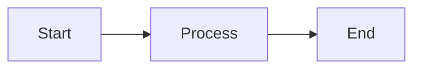

# Markdown 编辑

Plate WYSIWYG；用于普通笔记与论文 `NOTES.md`。磁盘上始终是标准 Markdown，保证 Vault 可被 Obsidian / VS Code 打开。

## 技术选型

| 库 | 用途 |
|---|---|
| `@platejs/*` 插件体系 | 基于某种 Slate 模型的富文本编辑 |
| `@platejs/link` | 标准 Markdown 链接输入、空节点归一化；保留自定义编辑气泡与 Vault 导航 |
| `@platejs/markdown` | Markdown ↔ 编辑器文档 序列化 |
| `@platejs/media` 等 | 图片等节点 |
| `@platejs/selection` + `@platejs/dnd` | 仅 live editor：块选与拖拽换位；内部块 id 不写盘 |
| 自定义双链插件 | `[[...]]` 输入、高亮、跳转；序列化必须写回 `[[...]]` |

原则：所见即所得；与 shadcn/ui 工具栏风格一致；Agent 写回的 Markdown 经反序列化再展示。编辑期间的权威状态是 Plate AST，保存时再序列化为 Markdown；应用不会在每次渲染时重新读取一份隐藏的 Markdown 源字符串。

## 能力

- 自动保存；可选顶部格式工具栏（`showEditorToolbar`）。论文 `NOTES.md` 工具栏右侧多一个「笔记」按钮（Cool Papers 图标 + 文案；悬停显示「获取 Cool Paper 笔记」），把 papers.cool 的 Kimi 解析追加进当前笔记（FAQ 为 `## Qn`，答案内原有 `###` 小节嵌在其下；去掉末尾「想要进一步了解论文」跳转 Kimi 网页的 CTA）。从广场 venue 入库的论文优先用已保存的 Cool Papers id / `source_url`（如 `38818@AAAI`），不再只靠标题精确搜索。
- **文档目录**：至少存在三个标题时，才在编辑器右侧四分之一高度显示层级标记，一级标题标记最长，后续层级依次缩短；收起时保持紧凑，悬停或键盘聚焦后以动效展开标题；展开后标题按层级缩进、在目录块内左对齐，depth marker 始终贴住同一右侧边缘，展开/收起与 hover 都不会让标记横向位移；滚动时以中性色高亮视口对应的标题，点击标题会在当前 Dockview 文档面板内平滑滚动并高亮目标。面板宽度小于 18rem 时隐藏目录条，正文同时收回为目录预留的右侧留白。
- **正文最大宽度**：Appearance → Markdown editor 的 `markdownMaxWidth`。`0`（默认）为面板全宽；可选 640 / 720 / 800 / 960 / 1120 CSS px，编辑列 `mx-auto` 居中。数值是 CSS px，不乘 `uiScale`。源码视图同样受该宽度限制，行号列一起收进居中列。导出 PDF / PNG 仍用导出面自己的页边距。
- **状态栏**：编辑器底部单行显示反向链接（悬停查看列表）、词数、字符数；词数与字符数把 `$…$` / `$$…$$` 公式源码一并计入（公式节点是 void，TeX 存在 `texExpression`，只走文本叶子会漏掉整篇公式），因此数学笔记的统计与磁盘 Markdown 基本一致；按面板宽度逐级降级（小于 18rem 隐藏反向链接，小于 11rem 再隐藏词数，字符数始终保留），避免窄面板下换行溢出。
- **窄面板标题**：一至三级标题字号随面板宽度分两档递减（小于 24rem、小于 18rem），避免窄面板下单个标题占满整屏并逐字换行。
- **标题上边距**：GitHub 风格固定阶梯，H1–H3 为 `mt-6`、H4–H6 为 `mt-4`，不随标题字号放大；文档第一个块不再叠加段前间距，笔记以 `# 标题` 开头时只保留编辑器 `pt-4`。
- **分隔线**：`---` / `___` 渲染为紧凑分隔条；void 块放不进光标，默认 Enter 无效果，现光标停在分隔线上或块选分隔线时按 Enter 会在其下方插入新段落并落入光标。
- **长文阅读性能**：编辑器未聚焦（阅读态）时，顶层块按 `content-visibility: auto` 跳过离屏块的布局与绘制，滚动、拖拽侧边栏或 Dockview 分隔条时只重排视口内内容；聚焦编辑时自动关闭，保证光标、选区与输入法语义不变。该优化仅对非 WebKit 引擎（Windows WebView2 等）启用（#702）。**WebKit 上改由拖动期间冻结布局兜底**：手势期间把 `@container/editor` 查询容器的宽度 pin 住、松手再还原（实测 42ms → 17ms/帧；真正的大头是容器查询的子树样式重算，不是文字折行），并自动覆盖 rail 拖拽与原生窗口缩放（见 [bug_fix/dockview-sash-pdf-resize-jank.md](../bug_fix/dockview-sash-pdf-resize-jank.md) §3.4）。
- **外部链接**：手写或粘贴标准 Markdown `[文字](https://…)` 会成为链接节点；普通单击打开编辑气泡（改显示文字与 URL），`⌘/Ctrl+单击`、中键或右键用系统浏览器打开；气泡内也有「打开」。`/` 菜单「外部链接」或右键「新增外部链接」直接插入链接节点（默认占位文字）并打开同一编辑气泡，而不是插入字面量 `[]()`。Vault 内相对 `.md` 链接与 `wiki:` 双链仍走站内导航。Vault 内 `.pdf` 链接（含 `%20` 解码后的空格路径）单击走 `openCitation` 打开 PDF，不经双链解析。PDF 支持 `#2.1` 章节与 `#2.1#p3` 段落简写，兼容 `#page=` / `#section=` / `#figure=` 等 fragment；这些链接走 `openCitation` 并跳到对应页/区域。`.tex` 可回退到同论文 PDF；Markdown 的 `#标题#子标题` 仍按标题文字解析。
- **Markdown 粘贴**：普通文本粘贴默认按 Markdown 反序列化，粘贴后光标保持在插入内容之后。若剪贴板携带 Slate 富文本片段（如编辑器内复制自身），优先恢复富文本 AST 节点，保留标题层级与节点属性，避免二次文本提取引入多余空行或重复双链文字。在空标题或既有标题块内粘贴单行纯文本/公式等无块级语法的文本时，按行内子节点插入并保持原标题级别，不会被降级替换为普通正文段落。片段解码复用 Slate 的 `insertFragmentData`（支持 MIME 与 HTML 属性）；应用只在插入前校验节点结构并保留块类型，畸形片段回退到剪贴板 Markdown 文本。
- **块选与拖拽**：编辑态悬停顶层块时左侧出现六点手柄（Notion 同款）。**悬停或点击手柄**打开操作列表（加入会话 / 复制 / 剪切 / 创建副本 / 删除）。「加入会话」把当前块（多选时为整组）序列化成 Markdown，按划词「加入对话」同样固定到 Agent 输入框并聚焦。**按住拖动手柄**在块之间换位（拖拽中禁止划词）。左 gutter 拖出虚线框可框选相邻块；多选后每个选中块保持显示手柄，任一手柄对整组复制 / 剪切 / 移动。空段落（Markdown 空行、文末 TrailingBlock）不是内容块：不显示手柄、也不画选中底色，但仍可随相邻块一起被框选移动以保留间距。在文字上拖仍是划词。`⌘A` / `Ctrl+A` 第一次选中当前顶层块（光标在代码行、Callout 内，或焦点在 Mermaid 预览等不可编辑区域时，也只框住该代码块 / Callout，不会扩成整篇），再按一次选中全部块。复制块写入 Markdown 纯文本。只读、导出面和 `![[…]]` 嵌入不显示手柄。内部 Plate 块 id 不写回磁盘。块拖拽用指针后端（非 HTML5）：macOS 上 wry 会吞掉 DOM `drop`，和文件树一样。长笔记下拖拽/框选的两个全局标志由单一订阅镜像成编辑器根节点上的 `data-dnd-dragging` / `data-dnd-selection-area`，块级样式走 CSS 后代选择器而非每块订阅；手柄的操作菜单 Popover 直到指针进入手柄才挂载。放置目标与 drop line 必须常驻——指针后端在拖拽途中不会触发「被拖过的那个块」去注册自己。
- **复制（文字 + 公式）**：选中一段文字时，如果选区里包含公式，`⌘C` / 右键「复制」会把整段按 Markdown 复制，公式保留为 `$…$` / `$$…$$`（此前走 DOM 纯文本，会拷出 KaTeX 渲染字形、丢失 TeX 源）；不含公式的普通选区仍复制纯文本。右键「复制为 Markdown」可对任意选区强制复制 Markdown 源码；块选（点块手柄或连按两次 `⌘A`）复制整块同样是 Markdown。文档不会在渲染态和源码态之间切换：`.md` 始终用 WYSIWYG 编辑器打开，需要逐字编辑源码时可用「导出笔记 → Markdown」或在外部编辑器中打开文件。
- **Slash 格式命令**：在可编辑正文中输入 `/` 打开轻量命令列表；使用上下方向键选择、Enter 执行、Escape 关闭。Slash 与双链候选会在可视窗口边缘自动翻转并限制高度；滚动编辑器时关闭候选，避免脱离光标。
- **美元符号**：`\$a\$` 是普通文本，`$a$` 是行内公式；行内公式两侧可直接接普通文字（如 `第一段$x_0$第三段`），编辑时继续输入不会吞掉公式；含 `cases` 等较高内容的行内公式 hover / 选中背景按公式盒子覆盖，不只覆盖文本行高；两者经编辑、粘贴和保存后保持不同语义。顺序输入 `$…$` 在闭合 `$` 处即时转换；若先输入 `$|$` 再补中间内容（无法逐字转换，因为公式是 void 节点、经气泡编辑），在光标位于 `$…$` 内时按 Enter 或离开编辑器即转换。逐字输入、粘贴与 Enter / 失焦转换共用上下文判断：代码块、行内代码标记及已有公式内保持字面量，避免 `$HOME$` 等代码被误转；代码内粘贴走 Slate 的 `insertTextData`，保留换行和标记。行内公式按基线对齐（`align-baseline`），与正文同一行基线。
- **独立公式**：`$$...$$` 渲染为块级 KaTeX；多行 `cases` / `aligned` 等高度较大的公式由整宽块级容器承载，hover / 选中背景覆盖完整公式块，超宽内容横向滚动，不会压到前后正文。
- **公式错误恢复**：未闭合的独立 `$$` 不会吞掉其后的 Markdown；围栏内的错误内容按普通文本保留，后续段落和标题继续正常解析。
- **正文小于号容错**：正文里 `<0.5B`、`p<0.05`，以及编辑器不支持的 `<Constraints>`、`<AI Paper Analyst>` 这类尖括号，不会再被当成未闭合 JSX 而截掉后面的内容（#533）。解析前把它们改写成 `&lt;`，编辑器里仍显示为 `<`。代码块、公式，以及真正支持的标签（`<div>`、`<center>`、`<iframe>`、`<p align>`、`<p>`、`<br>`、`<u>`、`<sub>`、`<sup>`、`<mark>`、`<kbd>`、`<callout>`）保持原样。详见 [bug_fix/note-markdown-stray-less-than.md](../bug_fix/note-markdown-stray-less-than.md)。
- **正文花括号容错**：正文里的 `{…}`、LaTeX 写法 `\max\{a,b\}`、`\(…\{…\}…\)` 不会被 `remarkMdx` 当成 JS 表达式而报错，更不会让 Plate 的 MDX 回退从某个 `$\rho<1$` 处把后文切掉（此前这类笔记会静默只剩前 11%）。解析前把代码块与公式外的 `{` / `}` 改写成 `&#123;` / `&#125;`，编辑器里仍显示花括号；万一仍出现 MDX 解析错误，反序列化会整篇改用无 MDX 管线重解析，内容不静默丢失。详见 [bug_fix/note-markdown-mdx-brace-truncation.md](../bug_fix/note-markdown-mdx-brace-truncation.md)。
- **Obsidian Callout**：`> [!important]` 等标准 marker 渲染为专用块，正文继续使用既有段落、列表、公式与双链节点。
- **内嵌 HTML**：`<div>`、`<center>`、`<p align="…">`、`<iframe>` 保留为 HTML 块并在编辑器内净化后真实渲染（居中、嵌入生效），单击块打开源码编辑气泡；保存逐字写回原文，不再被转义成 `\<div>`。裸 `<p>` 还原为普通段落，`<br>` 作为硬换行。其余标签（`<u>` `<sub>` `<sup>` `<mark>` `<kbd>`）沿用既有 mark 节点。详见下文「内嵌 HTML」。
- **代码块操作**：编辑态悬停或聚焦代码块时，右上角依次显示语言选择与复制按钮；只读预览只显示复制按钮。打开语言菜单（含「纯文本」）时焦点落在搜索框，可直接输入过滤。选择 Mermaid 语言后，源码下方显示实时预览。
- **内嵌图**（见下表）。
- **双链 / 嵌入**：Markdown 目标补全标题路径，PDF 目标补全编号章节和段落；PDF 章节候选按 Enter 确认，按 Tab 继续选择段落。Markdown 区段与批注预览只读，论文主 PDF 嵌入可直接批注并保存；详见 [wiki.md](wiki.md)。
- **双链边界换行**：光标位于双链源码节点首尾时，回车先将光标移到链接外再拆分段落，避免空的拆分节点继承链接属性并生成重复双链。
- **中文双链输入**：连续输入 `【【` 或 `［［` 自动转为 `[[`，沿用双链候选（`!【【` 同样支持嵌入；`！【【` / `！［［` 会连同全角感叹号一起转为 `![[`）；单个括号保留原样。代码、公式区域不转换；输入法组词完成后再转换，保存仍使用标准双链语法。
- **导出 PDF / PNG / Markdown**（桌面端）：工具栏分享按钮或右键「导出笔记…」。Markdown 格式直接把当前序列化内容（含未保存改动与 frontmatter）另存为独立 `.md` 文件。PDF / PNG 离屏只读渲染当前序列化内容；页面背景贴边；正文内边距对齐编辑器 `default`（`px-16 pt-4`，底边 `pb-10`）。默认完整展开 `![[…]]` 嵌入，就绪后用 `html-to-image` 截视觉层。**PDF**（`pdf-lib`）在位图上叠 **不可见可选中文字层**（DOM 测量 + Host `export_system_cjk_font`）与 **http(s)/mailto 链接注解**，再按 A4 分页；**PNG** 仍为纯位图。可选论文页眉、每页水印（logo + `muted-foreground`）。完整 PDF 附件嵌入为路径占位。导出默认带水印，可在对话框内临时取消。
- **外部改盘**：无未存改动则重载；有未存则 toast，不自动重载。同一 `NOTES.md` 的论文 PDF 标签没有未存标记，不能因此把笔记编辑器打回磁盘。本次刚写入的正文，以及与种子相同的内容，都不当成外部修改。主窗与文档弹出窗（「移动至新窗口」）各自监听本窗 Vault watcher，规则相同。
- **保存冲突**：写盘前比对上次落盘内容；磁盘已被外部改则中止并警告。自身写入按面板区分：同一编辑器的后续保存可在双链索引结束前继续排队，同路径的其他 Markdown / `NOTES.md` 面板则不能把它当成自己的写入。保存成功后，干净的兄弟面板按块复用就地重载（不变块不动，无整篇重挂闪烁）；已有未保存改动的面板保留草稿与原基线，立即提示冲突，并阻止自动保存、手动保存和卸载 flush 覆盖磁盘。提示中可选择「保留草稿」或「载入磁盘版」；后者只重载对应面板，并在点击时重新读盘。渲染态与源码态共用此流程，不自动合并文本。

## Markdown 源码视图

在可编辑的笔记面板中，点击工具栏的源码图标或按 `⌘/`（Windows/Linux：`Ctrl+/`）切换，也可从命令面板运行「切换 Markdown 源码」。快捷键可在「设置 → 快捷键 → 编辑器」修改。每个分屏独立；关闭再打开笔记时默认显示渲染视图。

源码使用 CodeMirror 的 Markdown/GFM 与 YAML 高亮，沿用正文的字体、字号和行高；正文宽度同样受 `markdownMaxWidth` 限制，限制加在整个源码视面上，行号列随居中列一起收进，不再贴面板左缘。行号使用等宽字体（`font-mono`），字号为正文的 0.8 倍。源码模式保留格式工具栏（标题、引用、加粗、斜体、下划线、删除线、行内代码、高亮、列表、图片、导出），按钮直接编辑 Markdown 源文本；`⌘B` / `⌘I` / `⌘U` / `⇧⌘X` 分别切换加粗、斜体、下划线和删除线。当前行从行号到正文连续高亮；展开和折叠共用与行号居中的箭头，只改变朝向。表格区分表头、单元格和分隔线，公式区分命令、数字和运算符。已标注 JavaScript、TypeScript、Python、JSON、YAML、HTML、CSS、Shell 或 LaTeX 的围栏按相应语言高亮。源码内按 `⌘F` / `Ctrl+F` 可查找、正则查找、逐个替换或全部替换；渲染视图仍用原查找条。源码与渲染分别撤销；切换时按光标（或选中块起点）的屏幕高度对齐，不把所在块滚到顶部；靠近文首或文末时按可滚动范围夹取，只做必要对齐。

源码编辑直接保存原文（包括空白与原有换行）；新增换行沿用文档首个换行样式。自动保存和 `⌘S` / `Ctrl+S` 复用同一套保存冲突检查。外部改盘时，无未保存改动则就地刷新源码；有未保存改动则提示，保留编辑中的文本。关闭标签或窗口前先尝试保存；发生冲突时保留面板以便处理。

切回渲染时，源码没变就复用原有 Plate 文档；有改动时全文解析一次，保留解析结果中相同的首尾块，只替换中间的变更范围。遇到跨块图片合并等需要重新规范化的边界，使用完整替换。解析失败时保留源码。源码态暂停图片引用回收，恢复渲染后重新统计引用。

桌面验收（macOS 26.6.2、Apple M5 Pro、Tauri 开发版）：以包含标题、链接、强调、列表和公式的笔记各测一次。切换耗时从触发到界面提交，括号内为同步转换耗时，单位 ms。首次打开文件的耗时不计入。

| 源码字符数 | 首次进入源码 | 未编辑切回 | 修改标题后切回 |
| ---: | ---: | ---: | ---: |
| 10,000 | 83（9） | 63（0） | 96（18） |
| 50,000 | 219（7） | 131（3） | 175（42） |
| 200,000 | 1,093（20） | 488（0） | 769（166） |

局部更新与完整替换逐块对照了标题修改、列表删项、尾部增块、清空文档和相邻图片合并。长笔记修改后切回仍可能超过 150 ms，界面更新也占用了时间；后续评估按块解析时，应单独测量解析和界面提交。

## 上游能力与适配边界

标准 Markdown 链接使用 `@platejs/link` 的 `BaseLinkPlugin` / `LinkRules.markdown()`：上游负责解析、插入、闭合后光标与 `removeEmpty` 归一化；本地只适配全角右括号、IME 整段输入、已经成为链接节点的 URL 粘贴，以及 Vault 相对路径。普通 URL 和 Markdown 粘贴仍共用 Markdown 反序列化管线；未闭合的 `[文字](` 内粘贴 URL 保留字面量，之后闭合得到单个链接。链接显示、编辑气泡与站内跳转由现有组件处理。参见 [Plate Link](https://platejs.org/docs/link) 和 [Plugin rules](https://platejs.org/docs/plugin-rules)。

工具栏只在真实文本选区上查询 mark 状态，块选切换产生的短暂容器端点会禁用 mark 按钮；不再全局包装 `hasMark` / `some` 吞掉异常。链接、公式和粘贴的上下文判断共用 `input-context.ts`。块拖拽仍只接收指针后端的编辑器节点，不挂载无法触发的 HTML5 文件 drop 分支。

## 阅读与打开性能

- **离屏块跳过渲染**：阅读态（编辑器未聚焦）顶层块 `content-visibility: auto`，滚动与拖拽侧栏/分隔条只重排视口内内容；仅非 WebKit 引擎启用。见 [bug_fix/markdown-read-jank-offscreen-blocks.md](../bug_fix/markdown-read-jank-offscreen-blocks.md)。
- **反序列化按内容裁剪 remark 插件**：解析前嗅探 `$`/`<name`/`:`/`[[`/`[!`/`@`，只挂载命中的 remark 插件（`remarkMdx` 分词 JSX、`remarkEmoji` 全篇扫短代码、`remarkMath` 解析公式在纯文本笔记上是纯开销）；序列化仍用全量管线，round-trip 不变。无 `<` 时同时传 `withoutMdx`，跳过 Plate 的 `htmlToJsx` 整篇扫描。
- **预处理按需执行**：`prepareMarkdownForDeserialize` 仅在存在连续空行 / `$$` / `<` / `{` `}` 时才跑对应的整篇扫描，纯文本笔记直接原样返回。
- **本地图片懒读 + 共享缓存**：图片节点进入视口（`rootMargin 800px`）才走 `readFile` → `blob:`；同一路径多引用与重开共用同一源（引用计数 + LRU=48 + 撤销），导出模式强制立即加载。
- **打开路径种子缓存**：`loadTabResources` 读 Markdown/NOTES 走会话内 LRU=24 文本缓存，外部变更由 Vault watcher 失效、写盘后回填；保存冲突检测与 `applyDiskChange` 仍读原始文件，冲突语义不变。
- **编辑器保活 LRU=4**：最近 4 个 Markdown / 文本编辑器常驻，切回跳过插件初始化与整篇反序列化。滚动位置按文件记在 localStorage（`agentero-md-scroll`）：同一次运行里被淘汰后重开，以及重启应用后再打开，都回到上次位置。
- **重块懒渲染**：Mermaid 预览、块级 KaTeX 公式与 `![[…]]` 嵌入进入视口才渲染/反序列化（导出模式立即渲染），长笔记首屏不为离屏图表/公式/嵌入买单；行内公式数量多且小，保持即时渲染。
- **反链查询延后**：状态栏反链在 idle（`scheduleIdle`，超时 2s）里查询，不抢首屏。
- **图片引用计数种子延后**：打开时不再同步遍历全树统计图片引用，改到 idle 执行；在它落地前自动保存跳过 asset GC diff，不会误删。
- **滚动期探针门控**：`onScrollCapture` 只在存在 `[[` 双链 / slash 候选菜单草稿时才跑补全探针（DOM 读取 + 编辑器树遍历）；纯滚动（含滚动条拖拽）不再每事件付探针成本。
- **自动保存单次序列化**：写盘前快照 `editor.children` 与 frontmatter 引用，写后按引用相等判断文档是否在写盘期间变动，只有真变了才做二次全文档序列化（此前每次保存固定序列化两遍）。
- **编辑器 memo 边界**：`MarkdownEditor` 按 props memo；`onDirtyChange` 在 DocView 内 `useCallback` 固定；`patchTab` 对无变化 patch 返回原数组与原 tab 引用——`notesDirty` 重复跳变、PDF 编译状态等 tab patch 不再重渲染其它面板的编辑器（Plate 全量协调）。
- **跳转优先于滚动记忆**：`navigationIntent`（`[[note#标题]]` / 块锚 / 划词来源跳转）生效期间，scroll-memory 的挂载恢复让位，不再把视图拉回旧偏移；记录滚动不触发渲染，写入 localStorage 有 400ms 合并，退出时立刻落盘。

三面板（PDF + 笔记 + 对话）同开的整体调优见 [bug_fix/notes-pane-jank-multi-panel.md](../bug_fix/notes-pane-jank-multi-panel.md)。

## 限制与后续

- **~~`@platejs/toc` 每 scroll 事件重建 IntersectionObserver~~**：已修复（`patches/@platejs__toc@53.0.0.patch`）。原实现里 scroll 监听每事件 `setStatus(Date.now())`，observer effect 依赖它，于是每个 scroll 事件都 disconnect + 重建 IO（每个标题一次 `NodeApi.get` + `toDOMNode` + `observe`）并全量重渲染 TOC（约 2–5ms/事件，与滚动距离无关）。现在 observer 长生命周期保留，滚动只按 rAF 合并做一次 diff 重挂（仅重新 observe DOM 节点真的换过的标题），也不再触发 React 状态更新。见 [bug_fix/toc-scroll-observer-rebuild.md](../bug_fix/toc-scroll-observer-rebuild.md)。
- **macOS 未启用块级 `content-visibility`**：见 §阅读与打开性能第 1 条与 #702；WebKit 逐元素 CV 只在内容进入视口时才 reveal（[WebKit #276735](https://bugs.webkit.org/show_bug.cgi?id=276735) 未修），打开它会把卡顿从拖拽搬到滚动，故仍不开。**拖动分隔条这一条已用「手势期间冻结重排」绕开**；仍未覆盖的是原生窗口缩放，以及拖动期间 `@container/editor` 的每帧 style recalc（见 [bug_fix/dockview-sash-pdf-resize-jank.md](../bug_fix/dockview-sash-pdf-resize-jank.md) §5）。
- **笔记滚动记忆是像素偏移**：记下 `scrollTop` 和当时的可滚动高度。文档仍够高时恢复原偏移；首屏高度不够（窗口变矮，或离屏块还没测高）则按比例落在当前范围内，避免被夹到文末。改字号、栏宽或正文后，位置会相对上次阅读点漂移。
- **外部重载按块复用**：`applyExternalMarkdown` 走 `applySourceProjection` 顶层块 diff，结构相同的块保留原节点（DOM 不动），只有变动的块区间被替换——外部改盘、Agent 写盘、同文件多面板的保存回显都不再整篇重挂（此前整篇 `setValue` 会因全部节点换新对象而逐块卸载重挂，面板闪烁、滚动被夹跳再恢复）。仍 `deselect()`；Agent 流式写盘打断输入光标的问题变窄到被改写块自身，后续计划替换后恢复 selection（pathRef 吸收位移）。
- **对话面板剩余 memo**：流式合帧与窄订阅已落地（见 [agent.md](agent.md)），composer / config bar 等与 lines 无关的子树仍随面板重渲染，待逐个补 memo。


## 内嵌图片

| 项 | 方案 |
|---|---|
| 落盘 | `{mdDir}/assets/`；正文 ``（Obsidian 兼容） |
| 插入 | 粘贴 / 工具栏 → `writeVaultBytes` |
| 预览 | 相对路径 → fs `readFile` → `blob:`；**选中**节点显示 Markdown 源码。选中描边固定为默认主题的 ring（不跟随外观配色） |
| GC | 引用计数归零且 managed `./assets/` 时删除文件 |

## 数据流

```text
打开文件
  → Host 读文本
  → 反序列化前把「段落间多余空行」改写成 Plate 空段落占位（零宽空格行），避免 CommonMark 合并
  → @platejs/markdown 反序列化
  → Plate 渲染

保存
  → 渲染态序列化 Plate；源码态直接读取 CodeMirror 原文
  → Host 写盘
  → watcher → 自写回声只刷新嵌入投影，不重建索引；外部变更按需重建 wiki 索引

外部/Agent 写盘（文件已打开）
  → 未保存改动时先提示；接受后打开中的编辑器就地重载新内容（同样走空行保留预处理）
  → 不重挂载编辑器（插件与 DOM 保留，滚动位置不丢），Agent 流式写入不再反复重建
```

### Properties（frontmatter）

编辑器工具栏提供 **Properties** 图标，点击后展开属性填写下拉表格：

- **表单模式（默认）**：左侧类型图标切换 **文本 / 列表 / 复选框 / 日期**（列表为 chips，复选框为开关，日期为 `YYYY-MM-DD`）；可添加属性。磁盘仍为合法 YAML（`true`/`false`、ISO 日期、block list）。
- **源码模式**：右上角切换为 YAML 正文（不含 `---` 围栏；保存时自动包回）。复杂 YAML（嵌套 map、多行标量等）自动回退源码。
- 清空属性即去掉 frontmatter；与正文共用自动保存 / dirty 状态。
- 常见用途：Obsidian 兼容 `aliases`，供双链搜索按标题命中该笔记（见 [wiki.md](wiki.md)）。
- 精读 skill 会在 `NOTES.md` 写入 `aliases`（论文全称 + 短标题）与 `created: YYYY-MM-DD`（已有创建日期不覆盖）；用户也可在此面板改。

### Slash 格式命令

输入 `/` 后，编辑器根据 `/` 后的连续文本过滤命令，条目统一显示图标与本地化文案。`/` 必须位于当前文本叶开头或紧跟空白，URL、转义斜杠、代码块和只读编辑器不会触发；Wiki 双链补全活跃时优先使用 Wiki 菜单，编辑器失焦后关闭菜单。执行前会再次核对当前光标、文本位置与 `/query`，选区已经移动或文本已变化时不会删除内容。

首版命令包含一级至三级标题、无序列表、有序列表、待办列表、引用、代码块、Mermaid 图表、添加内部链接、添加外部链接和 Obsidian Callout。`/mermaid` 会插入带 `lang: mermaid` 标记的 Plate 代码块；插入后光标在块内，直接显示源码，方便粘贴或修改。之后 Mermaid 块默认显示渲染出的图表，悬停右上角才出现复制、编辑等按钮，点编辑（铅笔）把块换回源码并把光标放进代码，光标离开块后自动回到图表；只读笔记和导出始终显示图表。预览与聊天消息共用 `MermaidDiagram`：配色/字体跟随亮暗主题与字体设置，宽图按容器等比缩放，超出预览区的内容在区域内滚动，不再横向撑开正文。需要普通代码块时仍使用 `/code`，也可以在代码块右上角的语言选择器中选择 Mermaid。“添加内部链接”和“添加外部链接”复用右键菜单的模板插入逻辑，分别插入 `[[]]` 与 `[]()`，并把光标放到可继续输入的位置；内部链接会继续打开双链候选。其他命令直接调用现有 Plate 块、列表与代码转换；Callout 使用 Agentero 已有的 Obsidian 节点，默认类型为 `note`，可以保留 `/query` 前的当前块文本。Callout 内仍可用 Slash 命令调整正文格式，但不会提供嵌套 Callout。完整 Plate SlashKit 中的 AI、Toggle、Columns、TOC、Date、Excalidraw 与通用非 Obsidian Callout 不接入。

`/mermaid` 的初始内容为：



### Callout

支持以下 Obsidian 形式：

```md
> [!important] 可选标题
>
> 正文可包含列表、$公式$ 与 [[双链]]。
```

已知类型使用对应图标与 light/dark 主题；未知但合法的 type 使用通用样式，并按原始大小写写回 Markdown。没有显式标题时只显示本地化默认标题，不向源码补写标题。标题行通过 Markdown hard break 与正文相连时仍可识别；`\[!important]` 的开括号已经显式转义，因此保持普通引用文本。逐字符输入完整的 `> [!important] 可选标题` 后按 Enter，会转换为 Callout 并将光标放入正文；转换不依赖粘贴。Slash 菜单也可以插入默认 `note` Callout。正文普通段落中的 Enter 只在当前 Callout 内拆分段落，不复制整个 Callout；列表和嵌套块继续使用各自插件的 Enter 语义。光标位于正文时，第一次 `⌘A` / `Ctrl+A` 只选中当前 Callout 的全部正文，再按一次才扩展为整篇文档。编辑态点击标题可直接行内编辑，标题输入框保持透明且无边框，失焦或按 Enter 保存，按 Escape 取消；点击标题左侧图标会打开带主题色图标和本地化名称的标准类型列表。修改后的元数据通过既有自动保存写回 marker。首版不支持自定义 type 输入、`+` / `-` 折叠 marker、嵌套 Callout、工具栏插入或拖拽换类型，这些语法保持普通引用文本。

## 内嵌 HTML

Markdown 已能表达的语法不做 HTML 语义化转换，只处理 Markdown 表达不了的能力。

| 写法 | 行为 |
|---|---|
| `<div>` `<center>` `<p align="…">` `<iframe>` | 成为 `html_block` 节点：编辑器内净化后真实渲染，源码逐字保留 |
| `<p>`（无 `align`） | 还原为普通段落（此前会嵌进另一个段落，结构非法） |
| `<br>` | Markdown 硬换行；保存写回 `\` + 换行 |
| `<u>` `<sub>` `<sup>` `<mark>` `<kbd>` | 沿用既有 mark 插件 |

单击 HTML 块在编辑器右侧展开 HTML 预览面板（`html-preview-panel.tsx`）：面板以 `clip-path` 从右边缘裁开，带 spring 过渡，`prefers-reduced-motion` 下仅淡入；宽面板占编辑器宽度的 72%（上限 42rem），`Esc` 或右上角关闭按钮收起。预览走与行内相同的净化结果，因此脚本/样式仍被剥离，只在更大的区域里阅读。悬停块右上角的铅笔按钮打开源码编辑气泡（原单击编辑改为该按钮，避免与预览手势冲突）。净化后为空（例如标签整体被剥离）时退化为等宽源码，保证内容仍可见可编辑。

Markdown 里指向本地 `.html` / `.htm` 的链接（`[report](./figures/report.html)`、`[demo](papers/x/demo.html)`）不再走只索引 Markdown 的 wiki resolver：相对路径先按源笔记目录解析，再回退 Vault 根路径，命中后把 `LocalHtmlViewer` 作为右侧分屏打开（`openHtmlPreviewLink`）。Agent 对话里的本地 HTML 链接同样由 `openCitation` 接到这条路径，避免落回系统浏览器或静默失效。Agent 常写绝对路径（`/Users/…/demo.html`、`C:\…\demo.html`），`isLocalHtmlLink` 一并接受，再由 `vaultRelativePath` 换算成 Vault 相对路径；绝对路径在 Vault 外时保持不处理。

渲染前经 `DOMPurify` 净化：剥离 `script` / `style` / 表单与内联事件，`iframe` 强制 `sandbox` + `referrerpolicy="no-referrer"` 且仅允许 http(s) `src`，链接强制 `target="_blank" rel="noopener noreferrer"`。应用未启用 CSP，因此净化是唯一防线——Markdown 文件始终保存作者原文，只收窄进入 DOM 的部分。

`@platejs/markdown` 解析前会把 `class` / `for` 改写成 JSX 拼写；编辑器会在取回源码切片和 HTML 代码围栏时还原。void 元素会被补成自闭合（`` → ``），这是一次性归一化，之后保持稳定。

## 代码

| 路径 | 职责 |
|---|---|
| `src/components/editor/` | Plate 编辑器；`index.ts` 是唯一对外出口，内部分 `nodes/` `plugins/` `hooks/` `embeds/` `toolbar/` `overlays/` |
| `src/components/editor/markdown-editor.tsx` | 编排容器：组合各 hook、keydown 派发、导出入口与整体布局 |
| `src/components/editor/toolbar/` | 格式工具栏与响应式溢出菜单。折叠数必须只由「工具栏自身宽度 + 固定尾部宽度」算出（`fit-actions.ts`，纯函数可测），**不能读折叠后的动作行宽度**，尾部也不能有随可见数增减的分隔线，否则会互相触发 ResizeObserver 反馈环（按钮持续闪，见 [resize-performance-research.md](../development/resize-performance-research.md) §1.14） |
| `src/components/editor/hooks/` | 有状态逻辑：自动保存、双链编辑语义、补全菜单、右键菜单、选区发布 |
| `src/components/editor/markdown-export-dialog.tsx` | 导出格式与选项对话框 |
| `src/components/editor/markdown-export-surface.tsx` | 离屏只读导出渲染（export mode） |
| `src/lib/markdown/export/` | 论文页眉解析、就绪等待、截图 / 可检索 PDF、保存 |
| `src/components/editor/overlays/frontmatter-panel.tsx` | 可折叠 Properties / YAML frontmatter 编辑 |
| `src/lib/markdown/frontmatter.ts` | frontmatter 围栏拆装与属性计数 |
| `src/components/editor/overlays/toc-sidebar.tsx` | 基于 Plate TOC hooks 的悬浮目录、当前标题跟踪与跳转 |
| `src/components/editor/nodes/block/code-block-node.tsx` | 代码语言选择、复制与 Mermaid 预览 |
| `src/lib/markdown/callout.ts` | Callout marker 解析、portable rules 与类型/标题的 AST 更新 |
| `src/lib/markdown/html.ts` | 内嵌 HTML 的 remark 变换与 portable rules（逐字保留 / `<p>` 还原） |
| `src/lib/markdown/html-sanitize.ts` | 渲染前的 DOMPurify 净化与 iframe / 链接加固 |
| `src/components/editor/nodes/block/html-node.tsx` | HTML 块渲染、右侧预览触发与源码编辑气泡 |
| `src/components/editor/overlays/html-preview-panel.tsx` | 编辑器内右侧 HTML 预览面板（裁切动画、Esc / 关闭按钮） |
| `src/lib/markdown/slash-command.ts` | Slash trigger、过滤、stale guard 与格式转换 |
| `src/components/editor/overlays/slash-command-menu.tsx` | 图标列表、键盘选择与浮层交互 |
| `src/components/editor/plugins/block-selection-kit.tsx` | 仅 live editor：块选插件与选中叠层 |
| `src/components/editor/plugins/dnd-kit.tsx` | 仅 live editor：块拖拽换位（指针后端；不接手 OS 文件 drop） |
| `src/components/editor/nodes/block/block-draggable.tsx` | 左侧拖动手柄、drop line 与拖拽/框选状态桥 |
| `src/lib/markdown/block-selection.ts` | 块选查询与 Markdown 序列化；void 块（分隔线 / 图）Enter 向下换行 |
| `src/components/editor/plugins/link-plugin.tsx` | 上游链接插件配置与整段输入适配 |
| `src/lib/markdown/link-input-rule.ts` | 上游 Markdown 链接规则的全角与富粘贴适配 |
| `src/lib/markdown/input-context.ts` | 文本选区校验与代码 / 公式上下文边界 |
| `src/components/editor/plugins/markdown-paste-plugin.ts` | Slate 原生片段解码、结构校验、Markdown 回退与标题保留 |
| `src/components/editor/plugins/markdown-kit.tsx` | Markdown 解析、序列化、粘贴与 Callout portable rules |
| `src/lib/markdown/image.ts` | 内嵌图 IO / GC |
| `src/lib/markdown/image-source-cache.ts` | 本地图片 `blob:` 源共享缓存（引用计数 + LRU + 撤销） |
| `src/lib/markdown/remark-plugins.ts` | 全量 remark 管线与按内容裁剪的反序列化选择器 |
| `src/lib/markdown/deserialize-md.ts` | 统一的反序列化入口（预处理 + 裁剪后的 remark 插件） |
| `src/lib/markdown/scroll-memory.ts` | 每文件滚动位置（localStorage，跨重启） |
| `src/lib/vault/seed-cache.ts` | Markdown/NOTES 打开路径文本种子缓存 |
| `src/hooks/use-in-view.ts` | 进入视口才执行重活的 IntersectionObserver hook |
| `src/lib/core/idle.ts` | idle 调度（`requestIdleCallback`，WebKit 回退短定时器） |
| `src/lib/core/paint-perf.ts` | 按引擎开启离屏块跳过渲染 |
| `src/lib/markdown/save-state.ts` | 保存与冲突 |
| `src/lib/vault/fs-watch.ts` | 文件变更重载 |

Vault 文件约定：[../backend/data-model.md](../backend/data-model.md)。

### 选区加入对话

正文选中文字后出现「加入对话」浮动入口，点击后可直接填写可选批注并确认加入聊天草稿。块手柄菜单的「加入会话」直接固定当前块，不经过批注框。引用插在 Agent 输入框当前光标之后，显示为行内引用块。批注绑定原文和笔记路径，不写入 Markdown 文件。编辑态和只读笔记均可使用，格式工具栏与右键编辑菜单不受影响。见 [agent.md](agent.md)。

选区「加入对话」确认后，在仍打开的原文旁显示编号批注角标；悬停查看批注，点击重新编辑。Markdown 右键菜单保留打开时的编辑器 RangeRef，并用 CSS Highlight 在菜单取得焦点时继续显示原文选区；关闭菜单时清除临时高亮。

批注输入点击外部会暂存，再点原句或重新选择同一处可恢复；Escape 明确取消。汇总中的来源按钮会定位并短暂高亮原文；重开笔记后使用原文及邻近文字重新定位，找不到或多处匹配时提示失败，避免错位。
