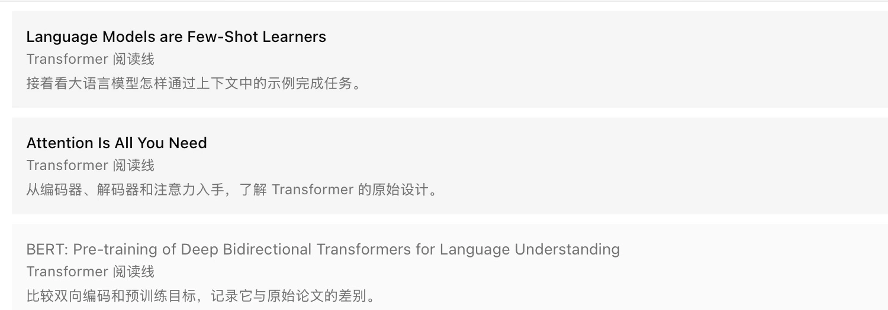
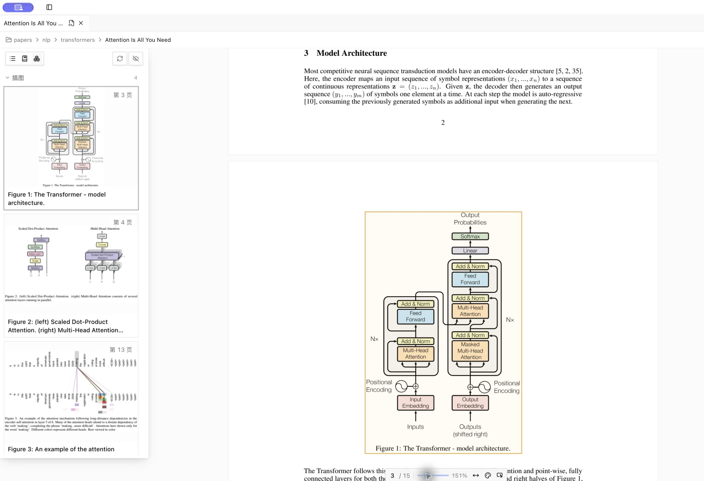
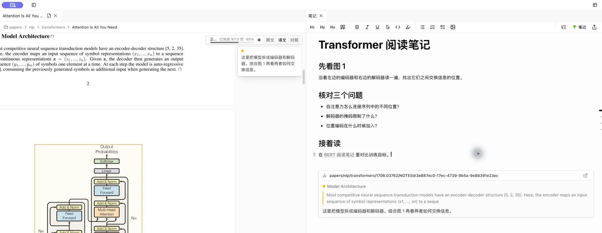
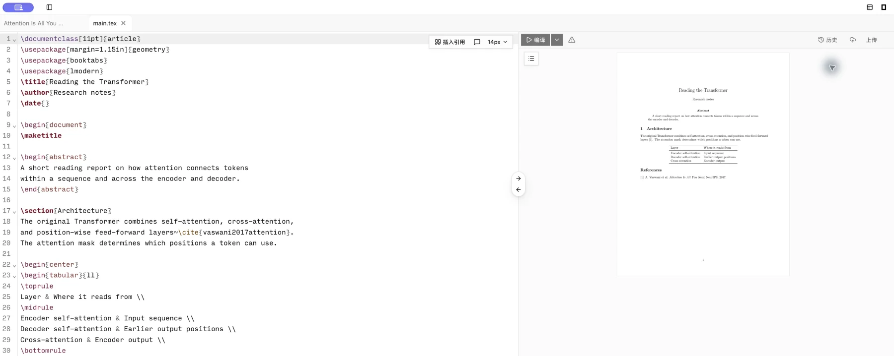

---
hide:
  - toc
---

# Agentero 用户指南

把论文、笔记和实验记录放在同一个知识库里。你可以跟踪新文献，边读边查证据，再把阅读和实验结果带进论文草稿。

[读完第一篇论文](usage/getting-started.md){ .md-button .md-button--primary }
[遇到问题](usage/help.md){ .md-button }

## 四个研究场景

- ### 持续跟踪一条研究线

    

    在订阅或 arXiv Daily 看候选，把感兴趣的摘要交给 Agent 比较，再选值得保存的论文。也可以查找近期有哪些新文章引用了库里的论文。

    [发现与管理文献](usage/import-papers.md)

- ### 看懂一张图或一条公式

    

    从解析面板跳到图、表、算法或公式。遇到交叉引用时可以先预览，跳走后再回到原处。读外文时可把原文和译文并排对照。

    [阅读、标注与翻译](usage/read-and-organize.md)

- ### 让一条笔记能回到证据

    

    把 PDF 的一条批注嵌进笔记，后来复查时点回原页。需要进一步核对时，可以把原文或裁图带进 Agent 会话。

    [写笔记与实验记录](usage/notes-and-tables.md) · [和 Agent 做研究](usage/agents.md)

- ### 从实验记录走到稿件

    

    新建实验记录时同时得到一篇笔记和一张表。开始写稿后，从论文库插入引用，在 LaTeX 源码和编译后的 PDF 之间定位。

    [做实验记录](usage/notes-and-tables.md) · [写作与引用](usage/writing.md)

