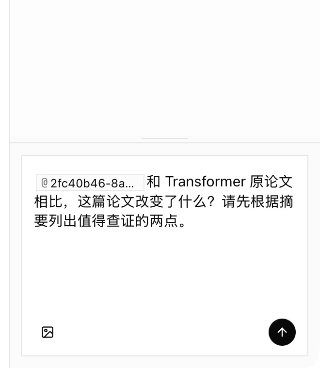

# 用 Agent 做文献研究

## 连接 Agent

1. 打开 **设置 → Agent**，点 **刷新** 检查电脑上的 Agent。需要安装或登录时，列表会显示 **安装**、**安装 ACP** 或 **登录**。
2. 等 Agent 就绪后，选一个作为默认 Agent。如果你已有 ACP 命令，可以通过 **添加自定义 Agent** 填写命令和参数。
3. 打开一篇论文，在右侧 Agent 栏试着问「这篇论文要解决什么问题？」。想查看工作区里的其他会话，点左侧的 **Agent** 进入 Zen。会话菜单可以切换 Agent。选定 Agent 后，菜单会显示它支持的选项，比如模型。

默认权限是 **受限**，应用会拒绝 Agent 发出的权限请求。想自己决定是否同意，选 **每次询问**。选 **自动批准** 后，应用会直接同意请求。发送消息时，你的问题和选入的材料都会交给所用的 Agent。用哪个模型服务、怎样处理数据，取决于你选择的 Agent。

## 在 PDF 上提问，回到原文核对

在 PDF 中选中一段文字，就能用浮动菜单里的划词提问。想把这段文字带到右侧的长对话里，选 **加入对话**。如果想给划词提问单独指定 Agent 和模型，打开 **设置 → Agent → PDF 划词提问**。

比较多篇论文时，在同一条消息里用 `@` 逐篇添加资料。可以问「这两篇论文用了哪些相同的数据集、基线和评估指标？请给出原文出处。」如果回复里有可定位的来源，点一下就能跳到 PDF 对应的页或段落。Agent 也可能在回复里附上表格、图示或文件。

[{ width="350" }](../assets/screenshots/agent.webp)

如果 Pi Desktop 消息里带有粘贴文本的临时附件，侧栏和 PDF 划词提问会用文件名标签显示它。将鼠标移到标签上，或用 Tab 聚焦，即可查看完整路径。

想接着聊，就从历史菜单打开原来的会话。换个研究问题时，可以在 Zen 里另开一个会话。

在 **订阅** 里打开一篇感兴趣的论文，点 **加入对话**，再把其他候选也加进来。也可以在输入框用 `@` 选广场条目或今日推荐。告诉 Agent 你在研究什么，让它先筛一遍摘要，再把想读全文的论文入库。

## 让 Agent 把精读写进笔记

准备好本地 PDF，再确认论文有 TeX 源码或已解析的 `PAPER.md`。然后在侧栏的论文项选择 **精读论文并写入笔记**。可以在后台任务里看进度。精读成功后，论文会被标为已读，打开它的 `NOTES.md` 就能查看生成的笔记。

在 **设置 → Agent** 可以为精读单独选模型，也可以开启 **入库后自动精读**。精读会写入笔记文件，并使用自动批准权限。

在输入框里输入 `$`，可以选用已安装的 Skill。输入 `/` 可以查当前 Agent 提供的命令。想找新的 Skill，就去广场看 **Skill 推荐**。安装前先看看它来自哪里、会执行哪些操作。

例如，用 `deep-research` 梳理一个主题，用 `idea-evaluator` 检查选题的证据与风险，或用 `research-paper-writing` 辅助写作。可执行的步骤取决于所选 Agent、材料和权限。

要让外部客户端通过 MCP 访问知识库，可查看[知识库与外部工具](vault.md)。
