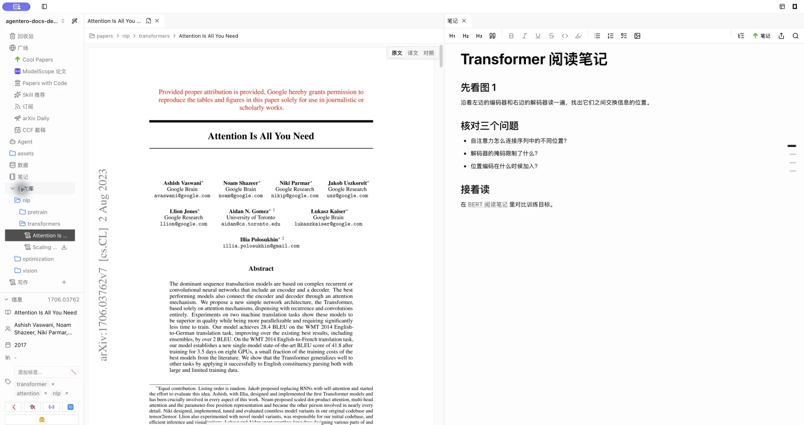

# 读完第一篇论文

准备一篇本地 PDF。打开论文，给摘要加一条高亮，再写一句阅读笔记。这条路线无需 Zotero、Agent 或模型账号。

## 安装 Agentero

到 [Agentero 发布页](https://github.com/poco-ai/agentero/releases)下载与你的系统和处理器匹配的桌面安装包。macOS 需要 12 或更新版本。Windows 有 x64 和 ARM64 安装包。Linux 的安装包依赖 WebKitGTK 4.1，Ubuntu 22.04 提供这个版本。

标题栏有新版本提示时，可查看更新详情，再安装并重启。若应用内更新失败，也可以从发布页下载新版安装包。

## 创建知识库

首次启动时，可以跟着配置向导选主题、设置网络和翻译服务。暂时没有 Agent 也可以直接开始阅读。

1. 在向导最后一步点击 **新建文献库**。如果已经进入工作台，点击左上角的知识库名称，选 **创建知识库**。
2. 选择一个独立的文件夹，方便之后找回或备份。这个文件夹就是知识库（Vault），里面会保存论文、笔记和其他资料。
3. 已有知识库时，在同一个菜单选 **打开知识库…**，选择它所在的文件夹。

## 导入并打开一篇论文

1. 把准备好的 PDF 拖到论文库，或者点击侧栏顶部的魔棒并选择 **导入 PDF**。
2. 打开左下角的后台任务，查看条目导入和资源下载进度。
3. 点击侧栏的 **论文库**，双击论文所在的行打开它。也可以按 `⌘P` 或 `Ctrl+P`，在 **快速打开** 里搜索标题。

想试试从网上导入时，可以在魔棒中输入 arXiv 编号 `1706.03762` 并点击 **添加**。

## 留下第一条高亮和笔记

在 PDF 里拖选一小段文字，点浮动工具栏的色块。松开选区后，页面上会留下一条高亮。有了高亮，再在 **笔记** 标签写一句自己的理解，例如「作者用注意力机制代替了什么？」。这个标签对应论文目录里的 `NOTES.md`。

如果正文旁没有笔记，用标题栏的 **布局** 菜单切到笔记布局。

继续查看[导入和整理论文](import-papers.md)、[阅读器里的批注和翻译](read-and-organize.md)或[布置工作台和快速查找](workspace.md)。
