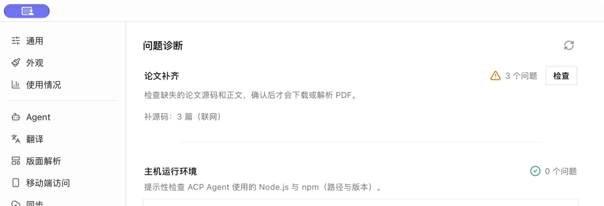

# 常见问题与诊断

## 论文已入库，但打不开 PDF

先看左下角的后台任务是否仍在下载，或是否提示超时。可以在论文行选择 **从来源下载 PDF**，也可以手动取得 PDF 后导入。需要机构权限的来源，可在 **设置 → 通用 → 机构代理** 检测是否仍处于登录状态。下载完成后，重新打开论文应能看到正文。只导入元数据时，论文仍会出现在论文库。

## 文件在磁盘上，论文库里却没有

检查当前知识库以及论文库的搜索、标签和目录筛选。如果已有论文目录在 `papers/` 下面，右键侧栏的论文库目录，选择 **重新扫描 papers/**。成功找回时会显示补入的数量。单独放进其他文件夹的 PDF，可按[本地 PDF 导入流程](import-papers.md)加入论文库。

## PDF 能看，但选不中字

用 PDF 查找一段眼前可见的文字。找不到时，这一页可能只有扫描图像，或文本层有缺损。可以在阅读器里尝试 **解析 PDF 正文**，或直接框选区域做视觉批注。正文解析的结果保存在知识库，用于后续阅读和精读。它不会给原 PDF 增加文本层。

## Agent 安装了，仍显示未就绪

在 **设置 → 问题诊断** 查看 **主机运行环境** 和 **Agent ACP 连通性**。命令缺失时检查 CLI 路径和 Node.js，提示未登录时用该 Agent 的 CLI 登录，握手失败时检查 ACP 适配器。超时可先查看 **网络连通性**。重新诊断后，回到 **设置 → Agent** 刷新，出现 **ACP 就绪** 后再发一条测试消息。ACP 探测本身不会发出提示词。

## 浏览器的 Zotero Connector 连接不上

打开 **设置 → 通用 → 集成**，确认 **兼容 Zotero Connector** 已开启且状态显示正在监听。端口被占用时，先退出 Zotero 桌面端，再重试。成功后，试存一篇公开论文，并在当前知识库确认条目出现。

## 双链点不开，或显示多个同名目标

先在笔记里用知识库相对路径指向正确文件，标题变过时也要检查 `#标题`。要批量检查本地知识库，在 **设置 → 问题诊断 → 双链语义** 点 **探测**。先看修复建议再选中要应用的项目。应用修复会修改对应笔记文件；修复后从原笔记点击链接，确认跳到预期的位置。

## 笔记提示已被外部修改

先复制重要的未保存内容，再决定保留哪个版本。选择 **载入磁盘版** 会舍弃本地草稿；选择 **保留草稿** 会用当前草稿覆盖磁盘上的新版。同步时出现冲突副本，可在核对两个版本后手动合并。需要找回刚删掉的文件，先查看知识库里的回收站。

## 精读或翻译一直没有结果

查看后台任务的失败信息。精读需要本地 PDF 和可读正文，缺正文时可以从 **问题诊断 → 论文补齐** 检查待下载源码或待解析文档，再确认运行。划词翻译先用短选区检查所选服务；全文翻译再检查版面解析和后台进度。成功时应能打开精读笔记，或看到选区译文。

## 全文译文有缺段

先确认后台任务已完成。在阅读器的 **部分译文** 菜单中点 **补全**，重新查看原先显示原文的段落。若页面本身识别不完整，可以选择 **重新解析并翻译**，这会重新生成当前论文的版面分析和译文。

## 第二台电脑没同步到 PDF

在两台电脑的 **设置 → 同步** 核对存储位置和 **同步范围**，确认都允许同步 PDF，再执行 **立即同步**。同步成功后，在接收端打开该论文确认可读。如果只有少数论文缺 PDF，也可以从原始来源单独下载。

## 提交一个可复现的问题

在 **设置 → 关于** 查看应用版本，也可以打开日志文件夹。反馈时附上操作系统、应用版本、触发步骤和错误提示。若提供日志或截图，先去掉密钥、配对链接和私人路径。
