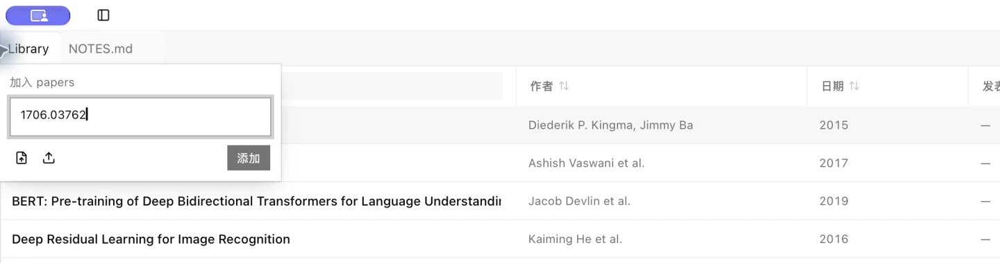
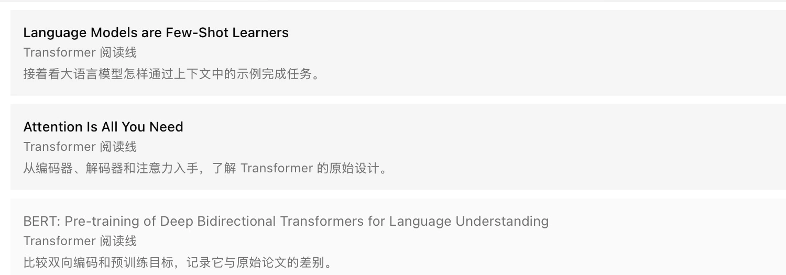
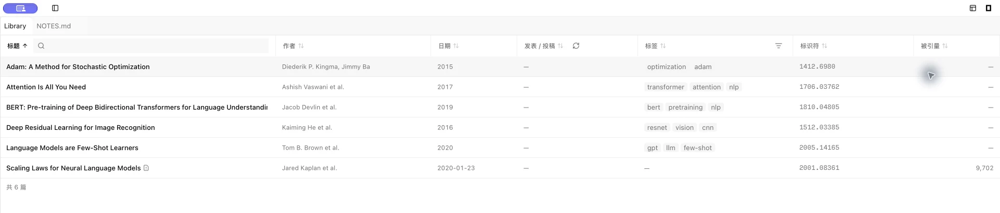

# 找论文、导入和整理论文库

## 按标题、DOI 或 arXiv 编号添加

点侧栏顶部的魔棒。输入 DOI 或 arXiv 编号可以直接查找一篇论文；只知道标题时，输入标题并从候选结果核对作者和发表信息，再点 **添加**。

有多篇论文时，可以把编号一起粘贴进去。魔棒也能从对话文本或公开的 ChatGPT 分享链接提取 DOI、arXiv 编号和 PMID，勾选需要的条目再入库。贴入普通网页地址时，保存的内容可能只有页面信息或网址。

## 导入本地 PDF 或书目文件

- 把 **PDF** 拖到论文库里，或从魔棒选择 **导入 PDF**。识别完成后，检查标题和作者是否正确。识别为库中已有的论文时，PDF 可以合入原条目。
- 导入**书目文件**时，从论文库菜单选择 **导入文献**，选中 BibTeX 或 RIS 文件。书目条目可以先入库，能否取得 PDF 取决于论文来源。

## 把 Papers 文件夹用作导入入口

打开本地知识库，在 **设置 → 通用** 确认 **自动收录 Papers 下新增的文件夹** 已开启。用文件管理器把 PDF 直接放进 `papers/`，或把内有 PDF 的新文件夹放到 `papers/` 的第一层。文件写完后，Agentero 会识别论文并加入论文库。收录时可能会按识别到的编号重命名主 PDF 和论文文件夹，同一文件夹的其他 PDF 会收进附件。想手动控制导入，可关闭这个开关。

## 发现新论文

侧栏的 **广场** 有 Cool Papers、ModelScope 和 Papers with Code 等来源。打开感兴趣的条目后再决定是否加入论文库。想持续跟踪某个来源，可以在 **订阅** 添加 RSS、Atom 或 arXiv 分区。**CCF 截稿**可以按领域和级别筛选。

**arXiv Daily** 根据本库论文的摘要对当天的新论文排序，需要库中有可比较的摘要，并且 Embedding 服务可用。想知道后来有哪些论文引用了你库里的文献，可以右键点击 **论文库**，选择 **发现引用我的新论文**，再从结果中勾选要导入的条目。

## 选择合适的搜索入口

| 要找什么 | 在哪里搜 |
| --- | --- |
| 在线查找尚未入库的论文 | 用魔棒搜标题或标识符，核对候选作者和来源。 |
| 已入库的论文 | **论文库** 表头按标题、作者、编号、DOI 或标签筛选条目。 |
| 知识库里的论文、笔记或科研表格 | **快速打开**。可以按标题或文件名找资料，也能匹配 Markdown 正文和笔记别名。 |
| 正在读的 PDF 里的一句话 | 在阅读器按 **⌘F** 或 **Ctrl+F**，搜索当前 PDF 的文字。 |

## 标签、阅读热力和资料补齐

1. 给论文加标签，或按主题放入论文库下的不同文件夹。只想查看某个主题时，点击 **按标签筛选**。
2. 需要记录阅读优先级等信息时，从表头添加单选或文本列。选中多篇后，可以批量复制到文件夹或删除。
3. 标题旁如果出现阅读热力标记，把鼠标停在标记上可以查看高亮、对话和翻译次数。

录入后发现信息有误，可以从条目菜单编辑或刷新元数据。只有元数据时，尝试 **从来源下载 PDF**。PDF 或源码缺失时也可查看 **下载论文资源**。论文库菜单里的 **导出论文库** 会生成 BibTeX，适合把书目带到其他工具。备份论文和笔记时请复制[整份知识库](vault.md)。

## 从 Zotero 收集、迁移或同步

| 任务 | 在哪里操作 |
| --- | --- |
| 从浏览器收集新论文 | 在 **设置 → 通用** 打开 **兼容 Zotero Connector**，在浏览器安装 Zotero Connector，然后点扩展的保存按钮。如果 Zotero 桌面端占用了同一个端口，先退出 Zotero。 |
| 搬来已有文库 | 打开左上角的知识库菜单，选 **从 Zotero 迁移**。先选一个独立的 Agentero 文件夹，再选含有 `zotero.sqlite` 的 Zotero 数据目录。扫描后选择条目以及是否复制 PDF、迁移笔记和批注、按收藏分类建文件夹。 |
| 更新两边已有的条目 | 在知识库菜单选 **与 Zotero 同步**。同步会先匹配两边的文献，按你的选择填补空的元数据字段、拉取 Zotero 笔记与批注，或把 `NOTES.md` 推回 Zotero。 |

推送前请先关闭 Zotero。Agentero 写入数据库前会在 `agentero-backups/` 建立备份，冲突条目会跳过。推送的笔记要在 Zotero 里编辑后，才会由 Zotero 的云同步上传。
