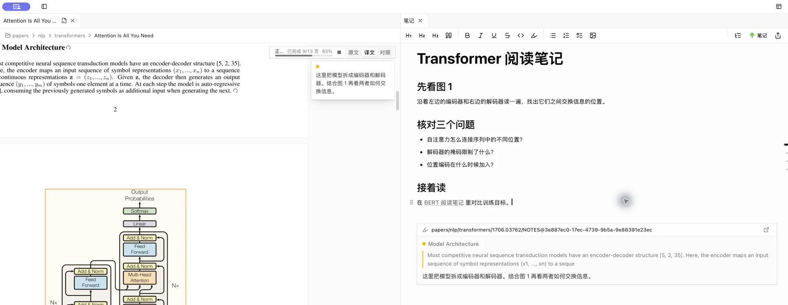
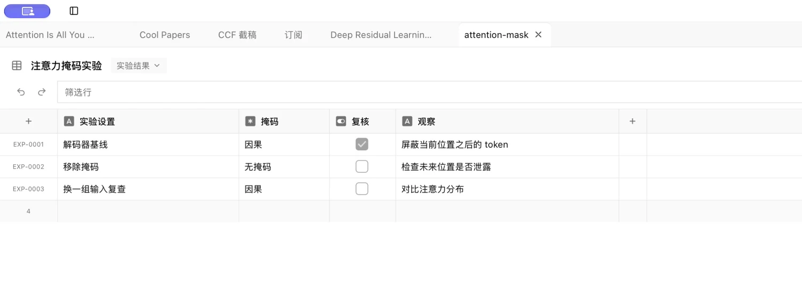

# 写研究笔记和实验记录

每篇论文都可以有自己的阅读笔记。想整理几篇论文共同讨论的问题、记录实验或写研究计划，可以另建一篇笔记。两种笔记都以 Markdown 文件保存在知识库里。

## 建一篇笔记

打开论文后，可以在并排的笔记栏中编辑它的 `NOTES.md`。如果没看到笔记栏，右键侧栏中的论文，选择 **打开笔记**。要另建一篇能关联多篇论文的笔记，在侧栏右键目标文件夹，选择 **新建文件**，文件名用 `.md` 结尾。

在可视化编辑器里输入 `/`，就能找到插入图片、内链、提示框或科研表格的命令。想看 Markdown 源码，点编辑器状态栏的源码按钮。用右上角的 **导出笔记** 可以把笔记存为 Markdown、PDF 或 PNG。

用 `$...$` 在文字中间写公式，用 `$$` 单独写一条公式。从 Cool Papers 等外部来源导入的 `\[...\]` 行间公式和 `\(...\)` 行内公式也会正常显示，编辑保存后保留原来的定界符。把代码块的语言选成 Mermaid，就能预览图表。用工具栏的 **属性** 查看和编辑笔记元数据。

## 把证据放进笔记

1. 在 PDF 里用视觉批注框出关键图表，写下你从图表里得出的判断。
2. 在批注卡片上选 **复制嵌入**，再粘贴到笔记里，就能直接看到批注。只想留个跳回原文的链接，选 **复制双链**。
3. 输入 `[[` 并搜索另一篇笔记。可以继续选择标题，用 `[[笔记名#标题]]` 指向具体小节。通过编辑器状态栏的反向链接，可以查看哪些笔记引用了当前文件。

例如，整理两篇论文对同一基准的结果时，可以在一篇综述笔记里分别嵌入它们的表格批注，把自己的比较写在旁边。

## 记录实验结果

1. 右键侧栏中的目标文件夹，选择 **新建实验记录** 并命名。应用会在同一目录创建一篇 Markdown 笔记和一张同名科研表格，并打开笔记。
2. 在笔记的「目的」「步骤」「结果」里记录过程。结果小节已经嵌入表格，打开表格即可填写数据。
3. 每行记一次实验。数据集可以用单选字段，结果用带单位的数值字段，实验时间用日期字段。填完就能排序或筛选。暂时不用的记录可以先归档，之后到 **显示已归档** 里恢复。

只想建一张表，在文件夹菜单里选 **新建科研表格**。在表格工具栏点 **复制嵌入**，可以把同一张表放进其他笔记。在笔记里可以预览表格，修改记录时再打开表格。要把数据带到其他工具里，选 **导出 CSV**。
