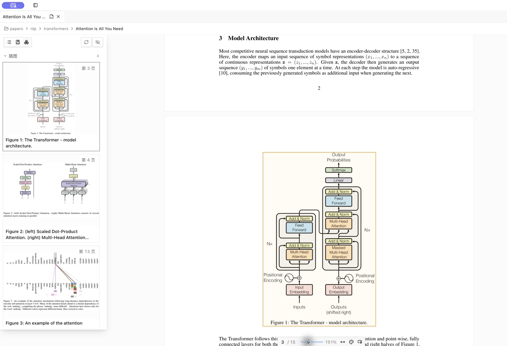
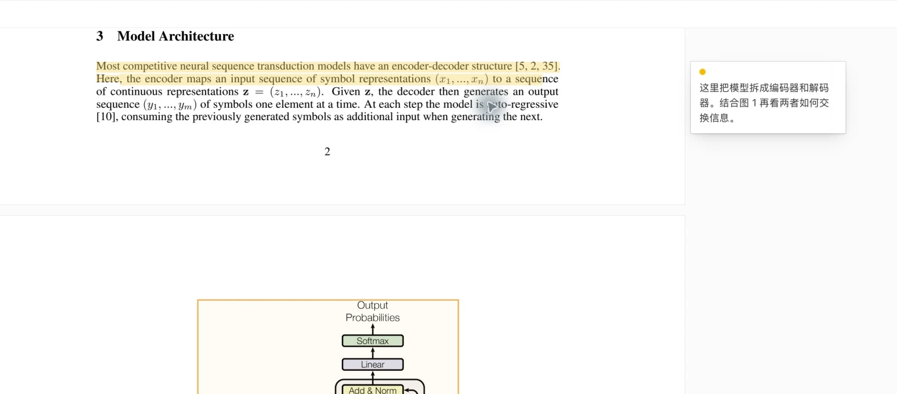

# 阅读、批注与翻译

在论文库双击一行，或从侧栏打开论文。如果论文有 HTML 版，可以从正文标签切过去，打开时需要联网。按 `⌘F` 或 `Ctrl+F` 搜索当前 PDF。

论文只有网页时，可以先按网页阅读。之后往论文目录里补入主 PDF，再从论文库打开同一条目，原标签页会切到 PDF，并保留笔记分屏；已经手动切到 HTML 的标签会继续保持当前视图。

## 看引用、图表和公式

- 点击正文里的引用或交叉引用，查看对应的参考文献、图、表、算法或公式。看完后，点 **返回跳转前** 接着读。
- 悬停在引文上可看摘要，点击条目下方的箭头可展开或收起详情。作者超过三位时，点击「其余作者」可滚动查看剩余名单。
- 悬停在一组编号引用（如 **[4–7]**）上，可以逐条导入。即使只有 PDF 参考文献原文，只要从该条中识别出 DOI、arXiv 链接或带 arXiv: 前缀的编号，就可以导入对应论文。
- 悬停在正文里的外链上，会先显示完整地址；停留片刻后换成目标网页的小窗预览，图片附件则显示缩略图。小窗里可以直接滚动、点开页面里的链接，站外链接会交给系统浏览器；右上角按钮用系统浏览器打开原链接。无法预览、加载超时或加载失败时仍显示完整地址。
- 点击阅读器左上角的 **参考文献**，筛选列表。找到想读的论文后，可以点 **导入文库**，也可以直接打开来源链接。
- 打开 **解析** 面板。完成版面分析后，点击图表或公式条目跳到所在页。打开 **选择版面元素** 后，可以选中识别出的句子、段落或图表。

扫描件等缺少文本层的 PDF，可能搜不到文字或选不中字。想提取正文，可以在工具栏点 **解析 PDF 正文**。也可以直接框出区域加视觉批注。能识别出哪些图表和公式，取决于版面分析的结果。

## 高亮、写批注和加书签

1. 在 PDF 里拖选文字，点色块加高亮，或右键色块切换到下划线。需要写下自己的想法时，点 **批注**。
2. 想批注没有文字选区的图表时，切到视觉批注，在页面上框出范围，再写备注。
3. 从批注菜单选择 **复制双链** 或 **复制嵌入**，粘贴到笔记。双链便于跳回原文，嵌入会在笔记中直接显示批注。可用菜单随批注类型变化。

在批注中可以用 `$…$`（或 `\(…\)`）输入行内公式，输入 `$$` 并换行可写独立公式。点击公式可修改 TeX；保存时保留 Markdown 公式源码。

| 操作 | 保存结果 |
| --- | --- |
| 在 Agentero 里高亮、加下划线或写批注 | 已入库论文的阅读标记随知识库保存在论文目录的 `marks/` 中。单独复制原始 PDF 时，这些标记不会一起带走。 |
| 在页面右上角添加书签 | 书签写入当前 PDF。需要文件可编辑，目录里的书签可以改名、排序和调整层级。 |
| **导出带批注的 PDF** | 在桌面端生成一份含 PDF 批注的副本，便于分享。Agent 对话仍保存在知识库。 |
| **导出双语 PDF** | 生成一份带原文和译文的阅读副本。导出前先检查是否仍有缺段。 |

可以在[研究笔记](notes-and-tables.md)中嵌入批注，写下它与其他论文或实验的关系。

**智能高亮（实验）** 在 **设置 → 实验功能** 中配置并开启。它根据 PDF 文字层和配置的模型标出重点，默认关闭。

## 查单词或翻译选中的文字

选中单词或短语，点击浮动工具栏里的 **翻译**。结果出来后，可以在 **词典** 和选区译文之间切换，也可以把卡片钉在页面上。想先查本机词典，在 **设置 → 翻译** 里选 **离线优先**。本机词典里有这个词就直接显示释义，没收录的词才会交给所选翻译服务。

划词翻译的原文会用随纸色变化的色带标记。多段翻译重叠时，色带不会加深；钉住译文后，重新打开 PDF 仍可看到对应的原文标记。译文卡片打开时，划词工具栏会避开卡片，尽量停在选区的另一侧，不会挡住工具栏上的按钮。

想请 Agent 解释选中的这段话，点 **快速对话**。想把选区和其他材料放在一起问，点 **加入对话**。[用 Agent 做文献研究](agents.md)

## 对照阅读和导出译文

1. 只需翻译一页时，点页边的 **翻译本页**。要翻译整份 PDF，在阅读器里点 **全文翻译**。这两种翻译都需要先分析页面版式。
2. 在 **阅读视图** 中切换 **原文**、**译文** 或 **对照**。**译文**覆盖在原文页上，**对照**把原文和译文放在两栏。悬停一句时，另一栏标出同一句：译文还没排好时按原文位置标，排好之后按译文的实际位置标。`Sec.`、`Eq.` 这类缩写和段首编号不会从中间切开句子。以前按旧边界存下的句对会重新翻译一次。
3. 从 **原文** 切到 **译文** 时，已有译文会立刻显示，缺译段落会自动补全。打开一篇已经停在 **译文** 的论文只显示已有译文，不会自动补全。补全失败时，黄色 **部分译文** 仍在，点 **补全** 再试一次。缺失的段落会暂时显示原文。若提示版面不完整，选 **重新解析并翻译**。需要带走译文时，选 **导出翻译 PDF** 或 **导出双语 PDF**。

放大到页面超出阅读区时，阅读区边缘会显示横向和纵向滚动条，可以直接拖动平移；原文和译文的阅读区都能这样拖动。

## 更换翻译服务

打开 **设置 → 翻译**，选择目标语言和翻译服务。使用自有的 OpenAI 兼容服务时，在相应服务卡片填入端点、模型和 API Key，确认后查看测试结果。端点应支持非流式 Chat Completions。服务需要特殊请求参数时，可在 **高级** 中填写 JSON 对象，留空会使用应用为该模型设置的默认参数。

选用在线翻译或云端版面解析时，相应的文字或页面会发送给所选服务。连接失败时，先检查端点、模型、密钥和应用内的网络代理。[常见问题与诊断](help.md)
