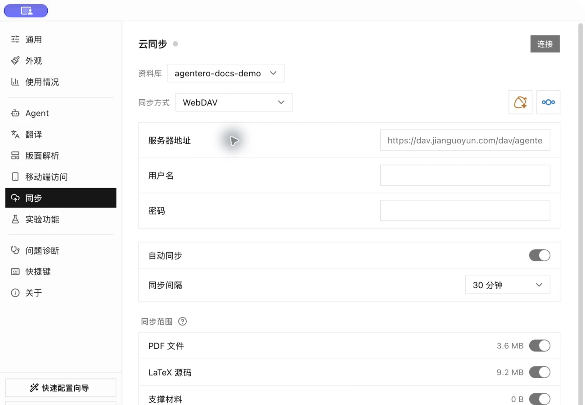

# 知识库、同步与外部工具

## 备份整个知识库

知识库（Vault）是一个文件夹。论文目录包含 PDF、`NOTES.md`、`marks/` 和已下载的源码或附件，独立笔记一般在 `notes/`。论文库里的结构化元数据保存在隐藏目录下的 `.agentero/catalog.sqlite`。

应用设置、阅读活动和 RSS 订阅保存在这台电脑的配置或数据目录里。换电脑后，可以在新设备重新配置代理和 Agent 等连接。误删文件后，先到当前知识库的 **回收站** 找，确认是要找的文件再恢复。

备份前先保存改动并退出应用，再复制整个知识库文件夹，别漏掉隐藏目录。如果有 PDF 链接指向知识库外的文件，也要备份那些文件。恢复时，把备份复制到新位置，用 **打开知识库** 选中它，再抽查几篇论文，看看批注、笔记和标签是否齐全。

## 选择跨设备访问方式

| 需求 | 方式 | 资料的位置 |
| --- | --- | --- |
| 在多台电脑上分别保留一份资料 | 对象存储、WebDAV 或 Git 同步 | 每台电脑各有一个本地知识库，通过同一远端同步 |
| 直接使用服务器上的知识库 | SSH | 文件保存在服务器上，客户端在线读写 |
| 在手机或平板查看电脑上的论文 | 移动端访问 | 资料在桌面端所在电脑，由在线桌面端提供访问 |

### 同步本地知识库

1. 打开本地知识库，进入 **设置 → 同步**。选择对象存储、WebDAV 或 Git，并填写服务地址和凭据。使用 Git 时，先在系统凭据助手或 SSH 中配置访问权限。
2. 点击 **连接**，再点 **立即同步**。连接状态旁显示 **上次同步** 时，可以到另一台设备连接同一远端并检查结果。需要定期同步时再开启 **自动同步**。
3. 在 **同步范围** 中选择 PDF、LaTeX 源码和支撑材料。笔记、元数据和标注始终同步。Git 的排除设置只作用于新文件，已跟踪的文件仍会同步。

[](../assets/screenshots/sync.webp)

服务器需要支持条件写入，才能用对象存储或 WebDAV 的标准同步方式。遇到冲突时，先看看原文件旁的冲突副本。使用 Git 同步时，冲突需要先用 Git 解决。切换同步方式前，要先解绑当前连接。

### 用 SSH 打开服务器上的知识库

macOS 和 Linux 上，先在终端确认可以用 SSH 登录服务器。在知识库菜单选择 **打开远程…**，输入 SSH 主机和远端知识库的绝对路径。主机可填 `user@host`，也可选取 `~/.ssh/config` 已配置的别名。连接成功后，知识库显示 **远程** 标记。若要使用 Agent，请在服务器安装并登录相应 Agent。

### 在手机或平板上查看论文

Android 用户可在发布页查看适用于 ARM64 的 APK，iPhone 和 iPad 需要有可用的 iOS 构建。在桌面端打开本地知识库，从 **设置 → 移动端访问** 开启访问。在移动端扫描二维码或粘贴配对链接，核对设备和确认码后在电脑上允许配对。

连上后可以搜索论文、看 PDF、保存笔记或使用桌面端的 Agent。使用期间保持桌面端在线。可在同一个设置页撤销设备。

## 用 CLI 或 MCP 连接外部工具

在 **设置 → 关于 → 命令行工具** 安装 CLI，再打开一个新终端。下面三条命令依次查看版本、列出知识库、查看指定知识库的信息。把最后一条命令里的目录换成你自己的知识库目录。

```sh
agentero --version
agentero vault list
agentero vault info --vault ./research-vault
```

支持 MCP 的本机客户端可连接 **设置 → 通用 → MCP** 中的服务器。开启后复制 HTTP 地址，并在客户端配置 `Authorization: Bearer <令牌>`。令牌保存在应用配置目录的 `mcp.token`，默认路径为 macOS/Linux 的 `~/.config/agentero/mcp.token` 和 Windows 的 `%APPDATA%\agentero\mcp.token`。若设置了 `XDG_CONFIG_HOME`，以该目录为准。

读取全文、修改知识库和联网各有开关，默认关闭。只有需要相关操作时再开启。需要通过 ChatGPT 隧道连接时，还要安装 `tunnel-client`，并提供隧道 ID 和 Runtime API Key。支持标准输入输出的客户端也可以直接配置 CLI 命令 `agentero mcp serve --vault ./research-vault`。

## 在 Word 中插入引文

Word 引文集成是 macOS 和 Windows 上的原型。先打开一个本地知识库并退出 Zotero 桌面端，再到 **设置 → 通用** 开启 **兼容 Zotero Connector** 和 **Zotero Word 插件**。在 Word 中使用已安装的 Zotero 插件，在新文档里试用添加引文和参考文献。支持 APA 7、IEEE 和 Chicago 作者—年份样式。

该原型只处理正文引文。请关闭 Word 修订，使用没有旧 Zotero 字段、脚注或尾注的文档。macOS 如果出现自动化提示，需要允许 Agentero 控制 Word。
