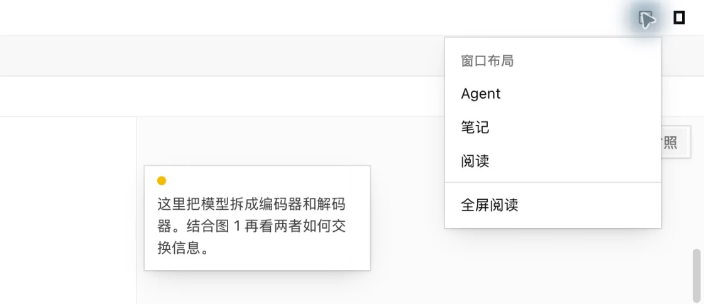

# 布置工作台并快速查找

## 切换布局或单独打开一个窗口

在标题栏打开 **布局**，按当前任务选择 **Agent**、**笔记** 或 **阅读**。阅读布局会最大化当前面板，再选一次可退出。打开 PDF 后可用 **全屏阅读** 隐藏侧栏和工具栏，按 `Esc` 恢复。

- 要并排比较文件，把标签拖到工作区边缘，等分栏预览出现再松手。右键标签还可以 **新建标签组**，单击组名折叠或展开，双击改名。
- 想把论文或笔记放到另一块屏幕，右键标签，选择 **移动至新窗口**。移出论文时，已打开的笔记会留在原工作台。
- 要单独打开 Agent 小窗，右键标题栏右侧的 Agent 图标，选择 **移动至新窗口**。单击该图标可以显示或收起工作台里的右侧栏。

再次打开同一个知识库时，主窗口会恢复上次保存的标签和布局。

## 用键盘找资料和执行命令

| 要做什么 | macOS 默认快捷键 | Windows / Linux 默认快捷键 |
| --- | --- | --- |
| 搜索论文、笔记或表格 | `⌘P` | `Ctrl+P` |
| 按名称找一条操作命令 | `⇧⌘P` | `Ctrl+Shift+P` |
| 向右分栏或打开旁边的论文笔记 | `⌘+\` | `Ctrl+\` |
| 重新打开刚关掉的标签 | `⇧⌘T` | `Ctrl+Shift+T` |
| 全屏阅读当前 PDF | `Shift+F11` | `Shift+F11` |

用 **快速打开** 可以按标题或别名找资料，也能搜 Markdown 正文。想找当前 PDF 里的一句话，用阅读器的查找功能。要找「切换 Markdown 源码」「导出带批注的 PDF」这类操作，可以在 **命令面板** 里搜。

想改快捷键，在 **设置 → 快捷键** 找到对应命令，再按下新的组合键。每项都能单独恢复默认值。配色、字体和界面大小可以在 **设置 → 外观** 调整。

在 **界面缩放** 输入 50 到 200 之间的整数百分比，按回车或离开输入框后应用。点输入框旁的恢复默认按钮可回到 100%。

## 从系统打开知识库

macOS 可在访达中右键知识库文件夹，选择 **用 Agentero 打开**。如果菜单缺失或应用位置变过，可在 **设置 → 通用 → 访达集成** 安装或更新入口。

在 Agentero 侧栏右键一个目录，可以用系统文件管理器或终端打开它。

## 回顾阅读和 Agent 用量

在 **设置 → 使用情况**，可以查看这周读了多久、读了多少篇论文、运行了多少次 Agent。这里也能看到近六个月的阅读和 Token 分布，以及花了最多时间阅读的论文。Agent 没有返回 Token 数时，会显示 **未报告**。要清除本机记录，打开 **设置 → 通用 → 隐私**。
