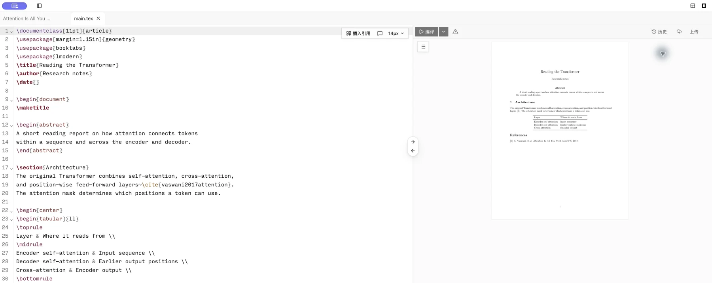

# 从论文库写论文

## 建一个 LaTeX 项目

1. 在左侧 **写作** 区域点击加号，选择 **新建项目**。
2. 填写项目名称，选择空白项目或 CVPR、ICML 等模板，并确认编译引擎。项目源码在知识库内的写作目录中，可用外部编辑器打开。
3. 打开主 `.tex` 文件。编辑区在左，编译后的 PDF 在右。多文件项目可以从文件列表切换章节，也可以在 **项目设置** 中调整主文件与编译引擎。

## 从论文库插入引用

把光标放在引用位置，点击源码编辑区的 **插入引用**。可以按题名、作者、年份或 DOI 搜索论文库。选中一篇论文后，应用插入引用命令，并在需要时写入 BibTeX 条目。再次插入同一条文献会优先复用已有条目。已有参考文献文件时，建议先确认主文档中的参考文献声明。

## 编译并检查 PDF

本地编译需要 `latexmk` 和项目选用的 LaTeX 引擎。点击 PDF 栏上方的 **编译**。编译出错时，从 **问题** 面板查看出错文件和行，或打开日志查看完整输出。编译成功后，从源码工具栏选择 **在 PDF 中定位**；也可以按住 `⌘`（Windows/Linux 用 `Ctrl`）点击 PDF，跳回对应源码。

PDF 栏编译菜单还提供 **实时预览**。这项功能需要 LuaLaTeX 和 realtime-tex 支持文件。普通编译可以继续使用项目原本选择的引擎。

## 审阅改稿，保留历史

在源码中选中一段文字并添加评论，通过编辑区上的 **审阅** 按钮查看评论、回复或标为已解决。需要让 Agent 处理某条意见时，可以从评论中选择 **加入对话**，把上下文随问题发给 Agent。

如需把源码纳入版本管理，可以从 PDF 栏的 **上传** 入口连接事先建好的 GitHub 仓库。每个项目单独使用一个仓库，上传源码和附件，跳过编译产物。上传后可以在项目的 **历史** 中比较修改，必要时恢复旧版。远端和本地都有冲突时，先在 Git 中处理冲突再重试。

使用 Word 写作时，可查看[知识库与外部工具](vault.md)中的 Word 引文配置。
